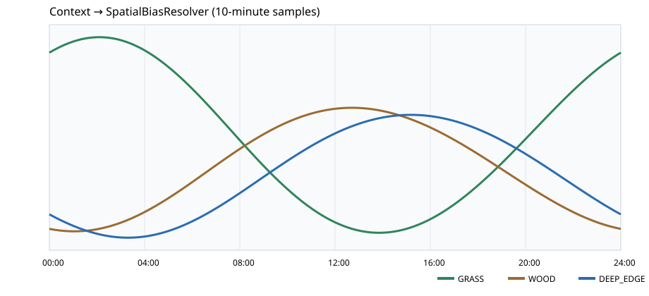

# Bass 动态偏好（Bass Dynamic Preference）｜原型闸门（Prototype Gate）验证

Document status：**RETAINED / PROTOTYPE GATE EVIDENCE**  
Authority：**V0 executable validation only; not an FCF V1 contract**  
Scope：`bass_dynamic_preference` prototype gates listed in this report.  
Reproduction：`python3 -m bass_dynamic_preference.run_prototype` and the pytest command below.  
V1 promotion rule：requires an explicit V1 owner decision and scoped review; this report cannot promote itself.  
Verdict：**PASS WITH DELTA**（仅覆盖本报告列出的闸门（gate））

本页只补充 `bass_dynamic_preference` 原可执行固定样例（fixture）测试挂具（harness）尚未覆盖的原型闸门（Prototype Gate）；不重新证明既有三时段策略故事。全部系数、概率与阈值均为 **TEST FIXTURE / TUNING PLACEHOLDER / NOT AUTHORITY**。

复现：

```text
python3 -m bass_dynamic_preference.run_prototype
PYTHONPATH=. pytest -q tests/test_bass_dynamic_preference.py
```

机器可读结果：`bass_dynamic_preference/prototype_output/prototype_results.json`。共享地图：`bass_dynamic_preference/prototype_output/generated_map.json`。连续解析器（Resolver）图：`bass_dynamic_preference/prototype_output/continuous_spatial_bias.svg`。

## 1. 覆盖审计（Coverage Audit）

### 之前（Before）

原测试挂具只有 3 个本功能测试：

1. `test_three_epoch_spatial_reorders_without_global_gain`
2. `test_three_epoch_feeding_reorders_without_appetite_gain`
3. `test_default_neutral_conditions_are_explicit`

此前的 `79 passed` 中，其余 76 个为旧仓库（repo）的 FCF V1 / 校准测试（calibration tests）。原型闸门要求的碎片化（fragmentation）、无关来源（unrelated-source）、连续解析器（continuous resolver）、觅食解析器（feeding resolver）和 O0/O1 测试（tests）当时均不存在。

### 之后（After）

本功能现有 11 个测试：保留原 3 个，新增 8 个。其中要求指定名称的测试已存在：

- `test_fragmentation_invariance_g1`
- `test_fragmentation_invariance_g2`
- `test_fragmentation_invariance_g3`
- `test_unrelated_source_does_not_change_existing_region`
- `test_context_change_is_smooth`

另新增觅食共模（feeding common-mode）、G1/G2/G3 地图（map）和 O0/O1 蒙特卡洛（Monte Carlo）三项验证。

## 2. 空间粒度（Spatial Granularity）｜G1 / G2 / G3

共享生成地图：3 个区域（zone）× 3 个栖息利用类别（habitat-use class）× 每格 5 个来源组（SourceGroup），共 45 个生态来源组。三种粒度（Granularity）使用同一地图、上下文（Context）与静态栖息偏好（Static Habitat Preference）。

| Metric | G1: Class | G2: Zone × Class | G3: SourceGroup |
|---|---:|---:|---:|
| Authoring parameter count | 3 | 9 | 45 |
| Runtime bias entries | 3 | 9 | 45 |
| 可表达模式身份（pattern identities） | 3 | 9 | 45 |
| 可表达局部模式（pattern） | class-global only | zone × class | individual SourceGroup |
| Far-distance coupled identities | 10 | 0 | 0 |
| Same-zone map edit max existing-bias delta | 0 | 0 | 0.011326 |
| Map-edit stability | STABLE | STABLE | COUPLED_WITHIN_CENTERING_SCOPE |
| Debug identity count | 3 | 9 | 45 |

实测解释：

- **G1：**成本最低，但无法表达 `NORTH/GRASS` 局部变化而不同时改变其它区域的 GRASS；本固定样例中联动 10 个远端来源组。
- **G2：**9 个参数即可表达区域局部（zone-local）的类别模式（class pattern）；远端不同区域不耦合，新增同类来源（Source）不改变键集合（key set）或既有 Bias。
- **G3：**局部表达最强，但配置编写（authoring）/运行时（runtime）/调试（debug）身份（identity）都增至 45；同一区域新增来源组会改变该区域的居中种群（centering population），使既有 Bias 最大漂移 0.011326。

本固定样例的证据支持 **G2 是三者中最低成本且同时满足局部表达、远端独立与地图编辑稳定性（map-edit stability）的方案**。这不是跨地图或正式权威升级（Authority promotion）；G1/G3 的失败/代价继续保留。

## 3. 碎片化不变性（Fragmentation Invariance）

生态来源 `A(weight=1.0)` 与十个技术对象 `A1...A10(weight=0.1)` 都先按稳定 `source_group_id=A` 聚合，再应用对应粒度的 Bias。

| Granularity | One object Local / Exposed | Ten fragments Local / Exposed | Max delta | Verdict |
|---|---:|---:|---:|---|
| G1 | 76.234678 / 60.987742 | 76.234678 / 60.987742 | 1.42e-14 | PASS |
| G2 | 77.603846 / 62.083077 | 77.603846 / 62.083077 | 1.42e-14 | PASS |
| G3 | 77.175826 / 61.740661 | 77.175826 / 61.740661 | 0 | PASS |

G3 没有天然失败：其语义键（key）是生态 `SourceGroup`，不是渲染/几何（renderer/geometry）技术对象。若 A1...A10 被错误赋予十个新的 SourceGroup IDs，变化将是语义配置编写变更，而不是技术碎片化；本实现不把这两者混为一谈。

**Fragmentation: PASS**

## 4. 无关来源独立性（Unrelated Source Independence）

对既有 `NORTH.GRASS.00` 记录强度（intensity），再加入远处不同区域的 `REMOTE.WOOD.00`：

| Granularity | Before Local / Exposed | After Local / Exposed | Delta | Verdict |
|---|---:|---:|---:|---|
| G1 | 60.987742 / 43.911174 | 60.987742 / 43.911174 | 0 | PASS |
| G2 | 62.083077 / 44.699815 | 62.083077 / 44.699815 | 0 | PASS |
| G3 | 57.293150 / 41.251068 | 57.293150 / 41.251068 | 0 | PASS |

G3 的居中范围（centering scope）是区域，因此不同区域的来源不耦合；同区域插入仍会发生上一节记录的 0.011326 地图编辑漂移（map-edit drift）。

**Unrelated Source Independence: PASS**

## 5. 连续上下文（Continuous Context）→ SpatialBiasResolver

解析器输入实际包含：

```text
time_of_day
light
water_temperature
temperature_trend
wind
```

它直接产生 GRASS、WOOD、DEEP_EDGE 的居中相对 Bias。一天按 10 分钟采样，共 145 个采样点（samples）；相邻任一类别的最大 Bias 变化为 `0.010594`，低于测试阈值 `0.02`。



解析器和输入本身连续，未使用 Morning/Midday/Evening 查找（lookup）、时段（Epoch）插值（interpolation）或滞回（hysteresis）。

**Continuous Resolver: PASS**  
**FishConditionEpoch Needed: NO**  
**NO ADDITIONAL EPOCH TRANSITION STRUCTURE NEEDED**

`FishConditionEpoch` 仍可作为描述性分析词，但本原型不需要对应运行时（Runtime）对象。

## 6. PreyState → DynamicFeedingPreferenceBias

测试输入：

```text
base    = (baitfish=.7, crustacean=1.3, worm=.9)
uplift  = (baitfish=1.4, crustacean=2.6, worm=1.8)
```

两者只相差统一的 ×2 共模（common-mode）活动提升（activity uplift）。居中解析器（centered resolver）对两者都输出：

```text
BAITFISH    0.730435
CRUSTACEAN  1.356522
WORM_LIKE   0.939130
```

最大 Bias 差值（delta）为 `0`。共模猎物活动（common-mode prey activity）不会成为全局食欲提升（global appetite uplift）；总体觅食驱动（feeding drive）继续由独立归属方（owner）表达。

**Feeding Preference Resolver: PASS**

## 7. O0 / O1 玩家观测实验（Player Observation Experiment）

搜索代理（Agent）只读取公开观测（Observation）；没有任何代码路径向代理暴露 SpatialUseBias、FeedingPreferenceBias、LocalIntensity 或 FeedingMatch。

- O0：`NO_EVENT / BITE`
- O1：`NO_PRESENCE_SIGNAL / PRESENCE_SIGNAL / FOLLOW_OR_REJECT / ATTACK`
- 搜索空间：3 个区域 × 3 个食物族群（food family）
- 蒙特卡洛（Monte Carlo）：2,000 次试验（trials），固定随机种子（seed）`20260902`

| Metric | O0 | O1 | Difference |
|---|---:|---:|---:|
| 找到最佳区域的平均探测（probes） | 23.23 | 19.48 | O1 -16.1% |
| 找到最佳食物族群的平均探测 | 22.16 | 34.26 | O1 +54.6% |
| Mean total probes | 45.38 | 53.74 | O1 +18.4% |
| 最终正确识别率 | 36.95% | 73.40% | +36.45 pp |
| 存在度（Presence）误判为响应（Response） | 58.21% | 0% | -58.21 pp |
| Probes per correct pattern | 122.82 | 73.21 | O1 -40.4% |

不得隐藏的负结果：O1 为了积累“存在条件下的食物响应（food response）”证据，平均食物探测（food probes）和原始总探测（raw total probes）更高。它不是无条件让每一步都更快。

但相同极简代理下，O1 将正确识别率近乎翻倍，完全消除本固定样例中 Presence→Response 误判，并将每次成功识别的等效探测成本降低 40.4%。因此分离信息显著降低的是**获得正确模型的学习成本**，不是所有原始采样计数。

**Presence/Response separated feedback worth preserving: YES**

这只验证信息价值，不设计最终 UI，也不要求新增机制层。

## 8. 闸门结果与审核结论（Gate Results and Verdict）

```text
G1:
  lowest cost, but FAILS zone-local expression without far coupling

G2:
  9 authoring/runtime/debug identities
  local pattern expression = PASS
  far-distance independence = PASS
  map-edit stability = PASS in this fixture

G3:
  maximum local expression
  fragmentation = PASS
  far-distance independence = PASS
  same-zone map-edit stability = DELTA (max bias drift 0.011326)
  authoring/runtime/debug cost = 45 identities

Fragmentation: PASS
Unrelated Source Independence: PASS
Continuous Resolver: PASS
FishConditionEpoch Needed: NO
O0 vs O1: 36.95% vs 73.40% correct; 58.21% vs 0% Presence→Response error
Presence/Response separated feedback worth preserving: YES
```

### 原型审核结论（Prototype Verdict）: PASS WITH DELTA

## 范围化审核结论（Scoped verdict）

```text
level: ARTIFACT
scope:
  - docs/bass_dynamic_preference_prototype_validation.md
baseline:
  - bass_dynamic_preference executable prototype and listed prototype gates
  - scoped_review_protocol.md default PATCH/ARTIFACT rules
proves:
  - 本报告列出的 fragmentation、unrelated-source、continuous resolver、feeding resolver 和 O0/O1 gates 有可复跑证据
does_not_prove:
  - V1 Authority、跨地图 promotion、production runtime 或完整机制闭合
open_findings:
  - 本报告标注的 PASS WITH DELTA 项仍需后续产品/证据裁决
verdict: ARTIFACT_REVISE
```

已通过的原型闸门：三种粒度均保持技术碎片化不变性（fragmentation invariance）；远处不同区域的来源不改变既有区域；上下文解析器（Context resolver）连续；共模猎物提升不侵犯食欲归属方（appetite owner）；O1 分离反馈有量化价值。

保留的偏差（Delta）/证据（Evidence）：

1. G1 不足以表达区域局部模式（zone-local pattern），不应作为本地图的完整目标（target）。
2. G3 在同区域居中范围内存在地图编辑耦合（map-edit coupling），并支付 5× G2 的配置编写/运行时/调试身份成本。
3. O1 提高正确性但增加原始食物探测（raw food probes）；其收益是降低正确模式成本（correct-pattern cost），而不是保证每项探测指标（probe metric）都下降。
4. G2 只在这份 45 来源的固定样例中表现最好；正式采用仍需其它地图密度与不均匀来源分布验证。

没有证据要求新增 FishConditionEpoch 运行时对象、插值、滞回、FishMode、FSM 或全局食欲分数（global appetite score）。
