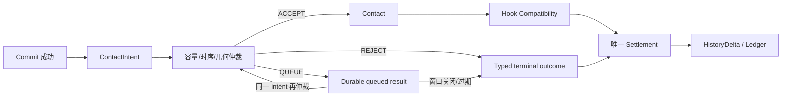

# FCF V1 接触 / 挂钩（Contact / Hook）机制设计（Design-only）

接触（Contact）与挂钩（Hook）都发生在承诺判定（Commit）之后，但解决不同
问题：接触决定“谁能占用这个接触窗口”，挂钩决定“已经发生的接触是否满足
装备/嘴部/时序兼容”。二者都不是进入（Entry），也不重新解释温度、DO、流速
或鱼的当前动机（motive）。

## 0. 快速阅读

**概念**：接触负责接触窗口的容量和仲裁；挂钩负责已发生接触与嘴部、装备、
几何和时序是否兼容；终结结算（Settlement）负责唯一终结记账。

**整体机制**：承诺判定成功产生稳定接触意图（ContactIntent）；接触按时间/
几何/稳定平局裁决身份仲裁，每个候选（Candidate）×窗口最多一个有效意图；
挂钩只消费下游兼容输入；最终由唯一终结结算交易归还、迁移、恢复或移除
质量。

**配置方式**：配置接触类型（ContactType）保留集（repertoire）、窗口/容量、
仲裁顺序、嘴部/钓组（rig）/几何兼容性、终态映射（terminal mapping）和交易
身份（transaction identity）；不能在这里修改 PSU 或历史。

**中文机制描述**：先决定“谁在这个窗口里真正碰到了目标”，再判断“这次接触
是否满足挂钩条件”，最后只结算一次；失败重试不能产生第二次接触或第二次
扣鱼。



## 1. 前置状态

只有以下链路成立后才允许接触：

```text
Candidate materialized
→ deterministic Encounter Conversion
→ COMMIT_READY
→ one Commit decision succeeds
→ ContactIntent
```

待定提案（Pending proposal）、未保留的对象、承诺判定失败或已终态的候选
都不得生成接触意图。

## 2. 接触意图（ContactIntent）

```text
ContactIntent {
  intent_id                  stable semantic ID
  candidate_id
  contact_type               declared Species repertoire
  contact_window_id
  event_time
  contact_point / geometry
  semantic_intent_id?        required for abstract ties
  capacity_class?            V1 fixed to DEFAULT; no per-class capacity
  snapshot_fingerprint
}
```

接触意图是承诺判定成功后的事实性请求，不保证一定获得接触。它必须携带
候选快照和稳定身份，不能每帧重建一个新意图。

## 3. 接触仲裁（Contact arbitration）

对同一 `contact_window_id`，仲裁器只做容量裁决：

```text
eligible intents
→ discard expired/invalid intents
→ order by (event_time, geometry priority, stable tie-break)
→ accept up to capacity
→ reject/queue remainder with typed reason
```

规则：

- `event_time` 与几何优先级必须来自快照，不能由处理顺序决定；
- 同一 `candidate_id × contact_window_id` 至多一个有效意图；重复意图必须
  被去重并产生类型化拒绝，若同一对携带不同载荷（payload）则拒绝为身份
  冲突，不能占用第二个容量槽位（slot）；
- 抽象平局必须提供 `semantic_intent_id`，否则拒绝为契约歧义；
- 稳定平局裁决（tie-break）使用意图/候选的稳定身份，不使用运行时对象 ID；
- 仲裁不改变 PSU、不重掷承诺判定、不重算遭遇；
- 被拒绝意图必须产生类型化结果，后续由终结结算/历史归属方处理。

仲裁本身也是可持久化事务：

```text
arbitration_transaction_id = stable(window_id + candidate/intent identities + snapshot)
→ durable ACCEPT/REJECT/QUEUE result
```

同一 transaction_id + 相同载荷重放必须返回原结果，不得再次占用槽位；
同一 transaction_id + 不同载荷必须拒绝为冲突。结果日志写入成功但响应
丢失时，重试只能读取原结果。

容量属于接触归属方（Owner）；“鱼是否值得接触”属于前置遭遇/承诺判定，
不能在仲裁器内偷偷加一个偏好分数（preference score）。

## 4. 接触类型选择

接触类型只能从物种能力的 `allowed_contacts` 中选择，并由遭遇快照或明确的
接触策略决定。变体（Variant）不能新增接触类型。

```text
contact_type = select_declared_contact_type(
  species_capability, presentation_truth, encounter_snapshot
)
```

选择必须确定性；若多个类型同优先级，编译期要求显式优先级或稳定平局
裁决，不能依赖枚举顺序。

## 5. 挂钩兼容性（Hook compatibility）

挂钩只读取接触后的下游事实：

```text
HookInput {
  contact_type
  mouth_geometry
  hook_geometry
  rig/tension/timing
  contact_point
  contact_duration
}
```

```text
hook_compatibility(inputs) → HOOKED | SLIP | NO_CONTACT
```

挂钩不读取原始物品 ID（raw item ID）作为鱼响应权威，不重新使用温度/DO/
流速，不修改 `A`、`E`、栖息占位（Occupancy）或 PSU。`NO_CONTACT` 只能表示
仲裁未分配接触窗口；`SLIP` 表示接触发生但几何/时序不兼容；二者必须区分。

## 6. 终结结算与历史

接触/挂钩只输出类型化结果：

```text
contact outcome
→ one settlement transaction
→ one HistoryDelta (if declared)
→ idempotent terminal state
```

接触归属方不能直接应用历史增量；挂钩归属方不能直接移动 PSU。所有终态
变更由终结结算归属方通过 transaction_id 完成。

## 7. 并发、重放与时序

- 同一 intent_id 重放必须返回相同仲裁结果；
- 同一接触窗口的并发意图必须在一个仲裁交易内裁决；
- 接触结果写入成功但响应丢失时，重试不得再占一个容量槽位；
- 已终结候选的接触/挂钩请求只返回终态/过期；
- 接触窗口关闭时，未接触意图不能被重新转成新的进入机会。

## 8. 编辑器

编辑器必须提供：

1. 承诺判定边界视图：显示承诺判定成功才允许接触意图；
2. 接触窗口/容量面板：窗口、容量、事件时间（event-time）、几何优先级；
3. 平局裁决面板：semantic_intent_id 和稳定排序；
4. 接触类型面板：物种保留集、优先级、变体限制；
5. 挂钩面板：嘴部/钩具/钓组/时序输入和 `HOOKED/SLIP/NO_CONTACT` 输出；
6. 终结结算/历史面板：类型化结果、transaction_id、增量归属方；
7. 重放追踪：同意图/窗口重放的相同结果。

编辑器禁止把仲裁偏好当作新的当前动机/E，禁止允许挂钩读取原始物品 ID
作为鱼类语义，禁止新增未声明接触类型。

## 9. 关键反例

1. 承诺判定失败仍生成接触意图；禁止。
2. 两个意图以运行时对象 ID 平局裁决；禁止，必须稳定身份。
3. 仲裁器用“更饥饿/更像目标鱼”的偏好分数抢容量；禁止。
4. 挂钩失败被写成进入拒绝；禁止，必须区分 `SLIP` 与 `NO_CONTACT`。
5. 接触成功后再次扣 PSU 或直接应用历史增量；禁止，终结结算/历史归属方
   负责。
6. 接触窗口关闭后把未接触意图重新掷成进入；禁止。

## 10. 最小闭合结论

```text
Commit success
→ stable ContactIntent
→ capacity arbitration
→ downstream Hook compatibility
→ one terminal Settlement
```

接触/挂钩机制在身份、容量交易、接触类型能力和终态归属方未闭合前，
不应实现成一个混合的“咬钩概率”函数。
