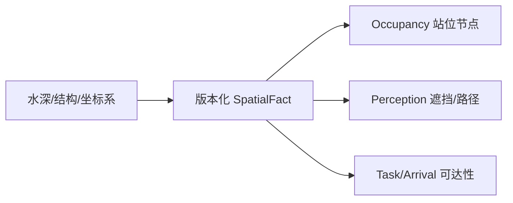

# FCF V1 深度与结构机制设计（Design-only）

深度和结构首先定义空间几何与栖息节点，不是一个“鱼更容易咬”的加成（bonus）。
V1 必须把空间事实、鱼的站位选择、呈现（Presentation）可达性和遮挡分开。

## 0. 快速阅读

**概念**：深度与结构是版本化空间几何事实，定义节点、边界、掩体和可导航体积。

**整体机制**：空间事实（SpatialFact）固定几何/坐标系修订版本；栖息占位（Occupancy）选择可停留节点，
感知（Perception）消费遮挡/路径结果，任务动作/到达（Task/Arrival）消费可达路径，彼此不改写同一后果。

**配置方式**：配置水深测量（bathymetry）、结构几何、遮蔽标签（cover tags）、可航行体积、
坐标系和修订版本；物种（Species）配置深度/通过能力；策略程序（Program）配置站位策略。

**中文机制描述**：先构造“水下空间是什么样”，再分别判断“鱼能否站在那里”、
“玩家信号是否可达”和“动作路径是否可执行”，不能用结构加成代替几何。

**作者成本伴随证据（companion evidence）**：深度/结构边界与草区、阴影、温度和 DO 叠加
时，静态手工 Region 的交叉切割压力见
[Ogre Lake reproducible overlay experiment](ogre_lake_reproducible_overlay_experiment.md)。该实验
只说明配置编写成本（authoring cost），不改变本机制的归属方（Owner）或闭合（closure）结论。



## 1. 世界事实（World Fact）

```text
SpatialFact {
  node_id
  bathymetry_depth_m
  structure_geometry_id
  boundary_mesh_revision
  cover_tags
  navigable_volume
  local_coordinate_frame_id
  measured_at / source_revision
  quality / uncertainty
}
```

`depth_m` 是节点几何事实；`structure_geometry_id` 指向版本化碰撞/遮挡
几何。结构标签（Structure tag）只能是物理描述（例如 ledge、vegetation、rock），不
能写成 `GOOD_FOR_BASS` 等鱼类解释。
`structure_geometry_id`、`boundary_mesh_revision` 和
`local_coordinate_frame_id` 会直接影响视线（line-of-sight）、可执行性（Actionability）和
路径（path），因此必须与 `source_revision` 一起进入机会（Opportunity）语义指纹（semantic
fingerprint）；网格/坐标系更新不能静默改变重放（Replay）结果。

## 2. 四种后果与归属方（Owner）

### 2.1 空间身份（Spatial identity，几何归属方 Geometry owner）

节点、深度和可航行体积决定 `population_slice_key` 的空间作用域。它们不
改变 PSU，只决定事实落在哪个节点/切片（Slice）。

### 2.2 栖息占位（Occupancy，种群归属方 Population owner）

```text
w_structure = habitat_profile(depth, cover, navigable_volume, slice_policy)
```

它只影响长期节点质量，再由栖息占位分配器（Occupancy allocator）做归一化、cap 和
守恒（conservation）。栖息占位不触发迁移交易（transaction），也不直接降低 `A` 或 `E`。

### 2.3 感知 / 硬可执行性（Perception / hard actionability，几何语义归属方 Geometry semantic owner）

```text
visibility_geometry = line_of_sight(structure_geometry, path)
actionable = capability_gate(approach_volume, task_envelope)
```

几何遮挡的语义归属方是几何/呈现关系；感知（Perception）
只消费其结果计算 `A_visual`，TaskCapability 闸门只返回 `ACTIONABLE/BLOCKED`。
该闸门输出必须带 `consequence_id`、归属方、阶段、输入修订版本和阻断
原因。它们不拥有长期鱼量，也不改变 `E`。

### 2.4 到达（Arrival）/T（路径归属方 Path owner）

只有结构或深度真实改变呈现路径/到达时间时，路径/到达
归属方才能计算 `T`。若运动系统已提供确定路径/到达时间，FCF 不得再次
用深度或结构重算到达加成。

## 3. 计算边界

### 3.1 深度

深度本身不是“越深越少鱼”的公式。它可被不同物种的栖息地剖面（habitat profile）
解释为长期适宜性，也可作为取温度/DO/流速剖面的空间索引；索引行为
不是第二个惩罚。

### 3.2 结构

结构几何（Structure geometry）至少要区分：

```text
cover_volume       可藏身体积
occlusion_surface  视线遮挡面
passage_width      可通过宽度
current_boundary   局部流场边界
```

这些是不同物理后果，只有真正被不同下游阶段消费时才可拆成不同
`consequence_id`。同一遮挡面不能既降低 A、又以“鱼不在”降低栖息占位（Occupancy）。

## 4. 不确定性与安全

- 几何修订版本明确且误差在边界内：`DEFINITE_GEOMETRY`；
- 路径/网格不确定性穿过可通过/不可通过边界：`GEOMETRY_RISK`，禁止
  新进入/原子保留/生命周期进入；
- fact `UNKNOWN`（未知）：V1 不新增该节点的栖息占位质量、不生成新遭遇候选（Candidate），
  保留已有切片（Slice），并在追踪记录写入 `UNKNOWN_DATA_BLOCK`；
- 不因几何不确定性随机销毁已有遭遇候选。

安全闸门（Safety gate）必须在任何新进入、原子保留或生命周期进入写入前执行。

## 5. 与环境因子的组合

| 事实 | 允许消费 | 禁止重复 |
|---|---|---|
| 深度（depth） | 位置索引、栖息地剖面 | 先扣占位再扣 A 的“深度惩罚” |
| 结构遮蔽（structure cover） | 占位或隐蔽（concealment，不同后果） | 隐蔽又写成鱼不存在 |
| 遮挡几何（occlusion geometry） | A_visual / 可执行性（Actionability） | 再由 E 扣同一遮挡 |
| 通行宽度（passage width） | 任务/路径可行性（feasibility） | 与流速/DO 对同一“到不了”后果双扣 |
| 局部流场边界（current boundary） | 规范 FlowFact | 结构和流速再各扣同一阻力 |

组合必须遵守 `fact → distinct consequence → one owner → stage`。

## 6. 编辑器

编辑器拆为：

1. 空间事实来源（Spatial Fact source）：深度、网格、节点、坐标系、修订版本、不确定性；
2. 栖息地策略（Habitat policy）：物种/切片对深度、遮蔽（cover）、体积的长期解释；
3. 几何关系（Geometry relation）：路径、遮挡、通行体积和呈现关系；
4. 任务能力闸门（Task capability gate）：任务包络、接近体积、阻断原因；
5. 到达模型（Arrival model）：是否由外部运动系统提供路径/到达；
6. 归属方图/追踪（Owner graph/trace）：显示空间事实如何进入栖息占位、A、可执行性（Actionability）或 T。

任何标签若包含鱼类判断、任何几何修改若改变能力，都必须
被编译器拒绝或标为能力/尺度变更；变体（Variant）不能新增通行能力。

## 7. 反例

1. 深度从 4m 变 6m，每帧重建切片并产生新进入；禁止，必须稳定 node/slice key。
2. 结构遮挡降低 `A_visual`，又降低栖息占位（Occupancy）作为“鱼离开”；同一后果禁止双扣。
3. 外部路径已给出到达时间，FCF 再从深度重算 `T`；禁止。
4. 网格不确定性穿过通行边界却随机选择可通行；应输出 `GEOMETRY_RISK` 并阻断新进入。
5. 结构标签写成物种特定解释（species-specific interpretation）；禁止。

## 8. 最小闭合结论

```text
Spatial facts
→ node identity / habitat / geometry relation / arrival path
→ distinct consequence_id
→ one owner
→ deterministic downstream use
```

深度与结构在稳定空间身份（identity）、几何修订版本、路径归属和归属方图未闭合
前，不应实现成一个全局 `depth_structure_multiplier`。
