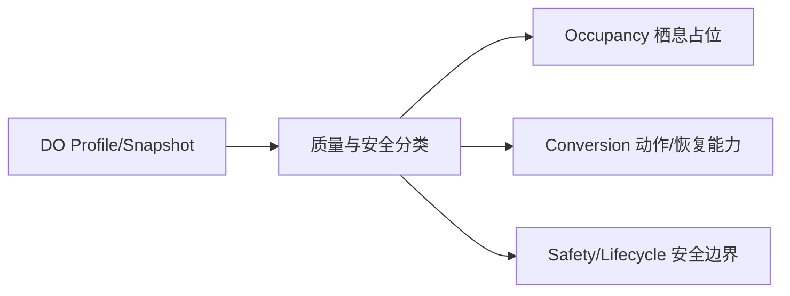

# FCF V1 溶解氧（DO）机制设计（Design-only）

> 作者成本旁证：DO 阈值轮廓与 Depth、Temperature 等边界不完全重合时，
> 静态手工 Region 的进一步切分见
> [Ogre Lake reproducible overlay experiment](ogre_lake_reproducible_overlay_experiment.md)。
> 该实验不改变本机制的归属方（Owner）、安全（safety）或计算契约。

DO 是水体事实，不是“鱼活跃度”或“咬口率”。V1 先把它拆成数据事实、
栖息占位（Occupancy）、动作性能和安全边界四个问题，再决定是否需要任何原型。

## 0. 快速阅读

**概念**：DO 是带空间、深度、时间、质量与不确定性（Uncertainty）的溶解氧事实。

**整体机制**：DO 快照（Snapshot）先做安全/UNKNOWN（未知）分类，再由不同归属方（Owner）解释为长期
栖息适合度、已在场鱼的持续运动/恢复能力或急性安全边界；默认不直接修改 A/E。

**配置方式**：世界事实（World Fact）面板配置 DO 剖面（profile）、单位、深度层和数据质量；物种（Species）
面板配置致死/应激/偏好/恢复/用力能力（lethal/stress/preferred/recovery/exertion capability）；策略程序/切片（Program/Slice）配置
回避阈值（avoidance threshold）、占位/任务/安全策略，不能扩展物种边界。

**中文机制描述**：先问“水里实际有多少氧”，再分别回答“鱼是否适合待在这里”
和“已经在这里的鱼还能否持续动作”，不能用同一个低氧惩罚（penalty）扣两次。



## 1. 语义分层

```text
DO snapshot
→ local habitat suitability       (Occupancy owner)
→ exertion / recovery capacity    (Conversion owner)
→ acute viability guard           (Safety/Lifecycle owner)
```

DO 默认不直接进入感知（Perception）`A` 或进入（Entry）`E`。如果低 DO 造成的是“该节点
长期不适合停留”，由栖息占位（Occupancy）结算；如果鱼已经在场但持续追击能力下降，
由遭遇转化（Encounter Conversion）结算。两者不能用同一个惩罚重新扣一次。

## 2. 数据事实

### 2.1 规范快照（Canonical snapshot）

```text
DissolvedOxygenFact {
  value_mg_l
  measured_at
  location_id
  depth_m / profile_id
  water_temperature_revision
  salinity_or_pressure_basis
  source_kind = SENSOR | HYDRO_MODEL | MANUAL_CALIBRATION
  quality = DIRECT | INTERPOLATED | STALE | MISSING
  uncertainty_mg_l
  source_revision
}
```

DO 的溶解度受温度、盐度和压力影响，但这些是测量/校准输入，不意味着
下游可以再把同一个温度后果重复解释一次。必须保留原始 DO 与校准后的
规范（canonical）值，不能由鱼解析器（Resolver）自己“根据温度猜 DO”。

### 2.2 空间与时间

DO 必须按 `location × depth × causal_cut` 取快照。不能用水面 DO
替代底层或温跃层（Thermocline）以下 DO。短时传感器缺口可在同一剖面内插值（Interpolation），但
跨越分层边界时必须标记 `UNKNOWN` 或 `STALE`，不能静默平均。

同一因果切点（Causal Cut）内所有解析器（Resolver）必须读取相同 `source_revision`；该修订版本
进入机会（Opportunity）语义指纹（semantic fingerprint），确保重放（Replay）不会因数据更新而偷偷
产生新 roll。

## 3. 鱼的属性与编辑边界

### 3.1 物种能力（Species capability）

```text
OxygenCapability {
  lethal_min_mg_l
  stress_min_mg_l
  preferred_min_mg_l
  recovery_rate_profile_id
  exertion_sensitivity_profile_id
}
```

这些字段描述物种/体型/生命阶段的生理能力。变体（Variant）不能把致死边界（lethal boundary）
改成物种未声明的能力；队列（Cohort）差异应通过独立物种能力（Species capability）或明确的
cohort 剖面表达，而不是运行时随意乘系数。

### 3.2 策略程序 / 切片策略（Program / Slice policy）

```text
OxygenPolicy {
  occupancy_mode
  avoidance_threshold_mg_l
  hysteresis_mg_l
  minimum_hold_s
  task_profile_id
}
```

策略（Policy）只决定当前切片（Slice）如何使用能力（例如是否积极离开低氧区），不扩大
生理边界，也不把低氧转成全局进入惩罚（universal entry penalty）。

### 3.3 历史（History）

```text
OxygenHistory {
  exposure_integral
  recent_min_mg_l
  recovery_debt
  last_transition_at
}
```

历史在 END-CUT 更新；遭遇候选（Candidate）快照（Snapshot）后，不能被后续实时 DO 读数悄悄
改写。`recovery_debt` 只由恢复归属方（recovery owner）结算，不能再由占位归属方（occupancy owner）
扣一次。

## 4. 可审计判断函数

V1 采用分段函数，避免未经校准的指数系数堆：

```text
occupancy_band(O; O_avoid, O_pref) =
  0                 O ≤ O_avoid
  ramp(O_avoid → O_pref)  O_avoid < O < O_pref
  1                 O ≥ O_pref
```

其中 `O_avoid` 是长期停留的回避阈值（avoidance threshold），`O_pref` 是偏好下限（preferred minimum）；
二者都高于 `lethal_min`。`lethal_min` 不参与栖息占位权重，只归急性
安全归属方（safety owner）。这样占位零权重只是长期分布预分配，不会与运行时
安全阻断或迁移共享“鱼不得存在”的结算权。

### 4.1 栖息占位（Occupancy）

```text
w_oxygen = occupancy_band(O_local, O_avoid, O_pref)
```

它只进入栖息占位分配器（Occupancy allocator）。分配器负责 cap、归一化和 PSU 守恒；
DO 解析器不直接创建/销毁鱼，也不触发进入（Entry）roll。

### 4.2 任务动作性能（Task performance）

```text
p_exertion = exertion_profile(O_local, recovery_debt, task_id)
```

它只影响已物化（materialized）遭遇候选的追击时长（pursuit duration）、爆发预算（burst budget）或
恢复时间（recovery time）。若任务剖面（task profile）已表达“低氧导致爆发能力下降”，进入（Entry）/E 不得
再次表达同一结果。

### 4.3 急性安全（Acute safety）

若 DO 测量区间明确落入致死区域，安全/生命周期归属方（Safety/Lifecycle owner）才能发出
`DEFINITE_HYPOXIA`；在事实明确前不得随机移除鱼。若不确定性（uncertainty）与致死
区域相交，采用 `HYPOXIA_RISK`：

- 禁止新的进入（Entry）、原子保留（Reservation）和生命周期进入；
- 不追溯销毁已有遭遇候选（Candidate）；
- 追踪记录（trace）记录区间、边界、质量、来源修订版本和阻断原因；
- 下一因果切点（Causal Cut）明确安全/致死后，才恢复或执行已声明策略。

## 5. 与温度、流速、深度的交互

交互必须先问“是否是不同物理后果”：

| 因素 | 允许的主要归属方（Owner） | 禁止的重复解释 |
|---|---|---|
| 温度改变 DO 测量溶解度 | 数据校准 | 再把同一变化作为低氧惩罚 |
| 深度导致 DO 剖面差异 | 局部栖息占位（local Occupancy）/几何（geometry） | 同一深度缺氧再扣一次 A |
| 流速改变补氧/能量成本 | 明确的流速（flow）或任务归属方（task owner） | 同一“追击更难”同时扣 flow、DO、E |
| 温度影响代谢率 | 任务性能剖面（task performance profile） | 同一代谢后果再扣 DO 性能 |

每条追踪记录（Trace）必须展示：

```text
physical fact → semantic interpretation → sole owner → downstream consumer
```

如果无法证明是两个不同的物理后果，默认只保留一个归属方。

## 6. 不确定性和缺失数据

相对于致死边界，区间完全在安全侧为 `DEFINITE_SAFE`，完全在致死
侧为 `DEFINITE_HYPOXIA`，相交为 `HYPOXIA_RISK`，无可接受快照（Snapshot）为
`UNKNOWN`。

`UNKNOWN`（未知）不得被替换成物种平均值。V1 默认采用“保守不生成新
遭遇候选（Candidate），保持已有切片（Slice），等待下一因果切点”的策略，并在追踪记录中
标记 `UNKNOWN_DATA_BLOCK`；产品若要放宽，必须作为显式策略版本化。
`HYPOXIA_RISK` 不是随机死亡判定。

## 7. 编辑器

温度与 DO 的编辑器可以共享框架，但不能共享隐含系数：

1. **事实来源面板（Fact source panel）**：传感器、单位、剖面、质量、不确定性、修订版本；
2. **物种能力面板（Species capability panel）**：致死/偏好/恢复/用力剖面；
3. **切片策略面板（Slice policy panel）**：占位、滞回（Hysteresis）、最短保持、任务剖面；
4. **因果归属面板（Cause-owner panel）**：显示 DO、温度（temperature）、流速（flow）、深度（depth）各自的唯一归属方（sole owner）；
5. **追踪面板（Trace panel）**：展示 `w_oxygen`、`p_exertion`、安全分类（safety classification）及
   受影响的下游阶段。

保存时必须区分 `WORLD_SOURCE_CHANGE`、`CAPABILITY_CHANGE` 和
`POLICY_CHANGE`；能力或 `q` 变化需要重新校准/评审签署（recalibration/reviewer sign-off）。

## 8. 关键反例

1. 水面 DO 高、底层 DO 低，却使用全局平均值；禁止。
2. 低 DO 降低栖息占位（Occupancy）后又降低 E；若是同一“鱼不在/不愿开始”的后果，禁止。
3. 传感器不确定性每帧触发新遭遇候选（Candidate）；禁止，必须因果切点（Causal Cut）+ 稳定 ID。
4. 低 DO 让遭遇候选追击时间变短，同时又减少一次进入（Entry）；禁止重复归属。
5. 变体（Variant）将低氧耐受提高到物种能力之外；禁止。
6. 温度→代谢、DO→代谢被当成两个独立惩罚，但没有可区分的任务动作（Task）后果；
   默认合并为一个声明清楚的性能剖面（performance profile）。

## 9. 最小设计结论

```text
DO fact snapshot
→ deterministic classification
→ occupancy OR task performance OR acute safety
→ one owner, one downstream settlement
```

在数据剖面、不确定性、物种能力和因果归属矩阵没有
闭合前，不应实现一个名为 `oxygen_multiplier` 的全局参数。
