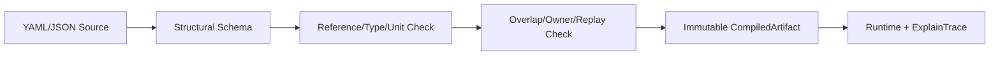

# FCF V1 配置编写领域专用语言（Authoring DSL）语义设计（Design-only）

FCF 领域专用语言（DSL）是声明式契约（contract），不是脚本语言。它描述事实
绑定、物种（Species）能力、切片（Slice）策略（policy）、解析器（resolver）
规则、归属方（owner）和追踪元数据（trace metadata）；不能表达任意执行流，
也不能把最终“鱼是否咬”写成一个可调系数。

## 0. 快速阅读

**概念**：FCF DSL 是版本化、声明式、fail-closed 的机制配置语言，不是脚本。

**整体机制**：YAML/JSON 依次经过结构校验、引用解析、能力/单位校验、规则重叠
（overlap）、归属方唯一性和重放（replay）检查，最后生成不可变（immutable）
`CompiledArtifact`。

**配置方式**：分别配置世界事实（World Facts）、种群定义（PopulationDefinition）、
物种（Species）、切片（Slices）、策略程序（Programs）、变体（Variants）、
解析器规则（resolver rules）、归属方矩阵（owner matrix）和追踪契约
（trace contract）；未知字段或未解析引用失败。

**中文机制描述**：作者只能描述“事实、能力、策略和规则”，不能在配置里写任意
程序、隐藏随机数或最终咬口系数；所有歧义在发布前被编译器拒绝。



## 1. 顶层命名空间

```text
schema_version
world_facts
species
population_slices
programs
variants
settlement_owners
resolver_rules
trace_contract
```

每个命名空间（namespace）有独立身份（identity）、版本和归属方。策略程序不得
嵌入 `population_slice_key`；变体不得改变物种能力（capability）或 `q`。

## 2. 编译阶段

```text
parse YAML/JSON
→ structural schema validation
→ identity/reference resolution
→ capability/type/unit checks
→ rule overlap and owner uniqueness checks
→ temporal/replay contract checks
→ immutable CompiledArtifact + diagnostics
```

任一语义错误（semantic error）都阻止编译；不能“尽量编译然后运行时再猜”。编译
输出必须携带源路径（source paths）、产物版本（artifact version）、输入修订版本
（input revisions）和诊断（diagnostics）。结构模式（Structural schema）对未知
root 或嵌套字段（nested field）一律拒绝；解析器（parser）不得静默丢弃未声明
字段，否则同一产物会被不同实现解释成不同语义。

## 3. 类型系统与边界

DSL 值至少有以下语义类型（semantic types）：

```text
WorldFact<T, revisioned>
SpeciesCapability<T, immutable>
Policy<T, slice-scoped>
HistoryField<T, end-cut>
Probability<A/T/E or declared decision>
ConsequenceId
OwnerId
TriggerIdentity
```

类型错误示例：

- 用 `WorldFact` 直接写入物种能力；
- 用 `HistoryField` 作为新的种群 PSU；
- 把 `A/T/E` 当通用加成（bonus）相乘；
- 用策略程序的策略新增物种未声明的 ContactType/task；
- 用 `ConsequenceId` 同时绑定两个结算 Owner（settlement owner）；
- 将运行时遭遇候选（Candidate）/个体 ID 写入静态产物（artifact）。

## 4. 可表达与不可表达

### 可表达

- 中性世界事实名称、来源、单位、质量（quality）、修订版本（revision）；
- 物种的 anatomy/sensory/contact/task 能力；
- 切片的生命周期（lifecycle）、栖息占位（occupancy）、当前动机/进入（Entry）策略；
- 版本化变体策略覆盖（policy override）；
- 明确优先级（priority）、触发（trigger）、滞回（hysteresis）、最短保持（minimum hold）；
- 每个后果（consequence）的唯一归属方和追踪（trace）字段。

### 不可表达

- 任意循环、递归、隐藏随机数或脚本副作用；
- raw `Fish × Item` 终态系数（terminal coefficients）；
- 鱼种专属世界事实（如 `GOOD_FOR_BASS`）；
- 未声明能力的变体扩展；
- 在 DSL 中直接创建遭遇候选、原子保留（Reservation）、接触（Contact）或终结结算（Settlement）；
- 依赖 map/YAML 字段顺序的语义；
- 通过新增乘数（multiplier）绕过已有归属方。

## 5. 规则语义

每条规则（rule）必须声明：

```text
rule_id
priority
when: typed predicates over snapshot
requires: capability references
then: one typed output
consequence_id
owner
effective_interval
```

相同优先级且谓词可能同时为真时编译失败。不同优先级按数值顺序选择一个结果；
不允许把多个结果相加成隐式得分（score）。`then` 不得跨命名空间写入状态，
只能产生该阶段允许的类型化输出（typed output）。
`effective_interval` 使用半开区间 `[start, end)`，单位和时钟域必须声明；
同一策略程序/切片内相同优先级的时间区间只要存在交集就视为重叠并拒绝。
相邻区间 `[a,b)` 与 `[b,c)` 不重叠；跨修订版本的区间不得静默拼接，必须
生成新策略版本（policy version）。

## 6. 概率契约（Probability contract）

概率字段必须标注其语义：

```text
accessibility A
arrival factor T
entry offer E
finite entry draw
commit decision
```

编译器拒绝未标注语义的 `multiplier`、重复因子归属方、以及把同一事实同时
接到同义后果的路径。真实随机边必须声明随机种子身份（seed identity）、重放
输入和消费阶段；动机（Motive）/遭遇（Encounter）默认确定性（deterministic）。

## 7. 引用（Reference）与修订版本（Revision）

所有引用都必须可解析：

```text
fact_id + source_revision
species_id + capability_version
program_id + policy_version
history_schema_version
geometry/frame revision
trigger identity
```

这些引用组成语义指纹（semantic fingerprint）。引用不存在、版本不兼容或修订
版本缺失时编译失败；不能自动取“最近版本”。

## 8. 变体（Variant）语义

变体是静态、扁平化的策略产物（policy artifact）：

```text
base Species capability
  + allowed policy overrides
  → flattened immutable variant
```

允许覆盖：动机优先级、栖息占位策略、进入机会等级（EntryOffer）、任务策略
中已声明的参数。禁止覆盖：`q`、种群身份、anatomy、感知/接触/任务能力、
历史结构模式（history schema）、结算 Owner。任何越权覆盖（override）都是
编译错误，而不是警告（warning）。

## 9. 编辑器行为

编辑器（Editor）不是文本框加保存按钮，而是 DSL 的类型化配置编写界面
（typed authoring surface）：

1. 根据语义类型展示可编辑/只读字段；
2. 每次编辑在临时产物上编译；
3. 显示源路径、重叠、归属方和能力诊断；
4. 显示 `fact → consequence → owner → stage` 图；
5. 保存只生成新的不可变产物版本；
6. 输出编译产物（compiled artifact）、diff、追踪预览（trace preview）和
   迁移元数据（migration metadata）。

编辑器不得自动排序相同优先级、补归属方、把缺失事实替成默认值，或在保存时
静默改变 `q`/规模（scale）。

## 10. 关键反例

1. 两个策略程序都写同一切片的终态行为（terminal behavior）；必须在引用解析
   （reference resolution）阶段拒绝，而不是依赖加载顺序。
2. 变体把 `q` 或致死能力（lethal capability）改掉；编译失败。
3. `resource_state` 同时进入栖息占位和动机，却共用 consequence_id；
   编译失败。
4. 规则通过新 `multiplier` 绕过 A/T/E 归属方；编译失败。
5. 触发没有稳定的身份/修订版本；编译失败。
6. DSL 中出现脚本随机或副作用；语言层禁止。

## 11. 最小闭合结论

```text
typed declarative source
→ fail-closed semantic compiler
→ immutable, revisioned artifact
→ deterministic runtime contract
```

DSL 在类型、引用、归属方、修订版本、随机边界和不可表达集合未闭合前，不应
继续增加语法糖或字段数量。
