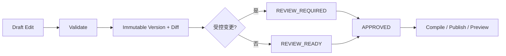

# FCF V1 编辑器（Editor）交互 / 校验（Validation）设计

本文件把结构模式驱动（schema-driven）的编辑器细化成工程可实现的交互与状态
契约。编辑器是版本化产物（artifact）的配置编写界面（authoring surface），
不是运行时调参控制台。

## 0. 快速阅读

**概念**：编辑器是 DSL 的类型化配置编写界面，负责编辑、校验、版本、评审
（review）、预览（Preview）和迁移（migration），不直接修改生产中的遭遇候选
（Candidate）或账本（ledger）。

**整体机制**：每次编辑在试验草稿（trial draft）上执行；结构模式/语义校验通过
后保存不可变版本（immutable version）；受控变更强制评审人批准（reviewer
approval）；运行时（runtime）只读取编译产物（compiled artifact）。

**配置方式**：按种群（Population）、物种（Species）、切片（Slice）、策略程序
（Program）、变体（Variant）、世界事实（World Fact）、归属方（Owner）、规则
（Rule）和呈现（Presentation）面板编辑；检查器（Inspector）显示类型、单位、
归属方、修订版本影响（revision impact）。

**中文机制描述**：编辑器不替作者猜默认值，也不把错误降级为 warning；它把每项
修改会影响什么、由谁拥有、要重跑哪些验证明确展示出来。



## 1. 页面结构

```text
Artifact selector / version / review status
├─ PopulationDefinition
├─ Species Capability
├─ Population Slices
├─ Behavior Programs
├─ Variants
├─ World Fact Bindings
├─ Consequence Owner Matrix
├─ Resolver Rules
├─ Presentation Compiler
└─ Preview / Explain / Migration
```

右侧检查器对当前字段固定显示：语义类型、单位、归属方、源路径、继承来源
（inherited-from）、修订版本影响、校验状态（validation state）。只读字段必须
显示为什么只读，不能仅禁用控件。

## 2. 字段控件与语义

| semantic type | 控件 | 必须显示 | save blocker |
|---|---|---|---|
| physical scalar | 数值 + 单位 | range、uncertainty、source | 单位/范围缺失 |
| bounded interval | 双端点 | inclusivity、包含关系 | inverted/illegal nesting |
| capability enum/set | 多选 | Species allowlist | capability expansion |
| ordered priority | 显式有序列表 | tie/overlap diagnostic | duplicate/equal-priority overlap |
| reference | searchable selector | exact version/revision | unresolved/latest implicit ref |
| policy override | path/value editor | base value、owner、diff | path 不在 allowlist |
| consequence owner | 单选 owner | upstream fact/downstream stage | missing/duplicate owner |
| trigger | typed form | trigger ID、debounce、hysteresis | unstable identity |
| effective interval | `[start,end)` editor | unit、clock domain | overlap/invalid boundary |

世界事实只编辑来源绑定（source binding）、单位、质量和修订版本策略
（revision policy）；鱼类解释只在物种/策略程序面板编辑。编辑器不提供
`GOOD_FOR_BASS`、`bite_multiplier` 等混合字段。

## 3. 继承与变体（Variant）视图

变体页面必须同时显示三列：

```text
base compiled value | requested override | flattened effective value
```

每个覆盖（override）先检查 `POLICY_ALLOWLIST`，再检查值是否仍在物种能力内。
多个补丁（patch）同一路径按显式优先级解析；同优先级冲突阻止保存。运行时
只接收扁平化产物（flattened artifact），不自行合并。

能力（Capability）、种群定义（PopulationDefinition）、归属方与身份字段在变体
页面只读。若用户确实要改，编辑器必须引导创建对应的新边界修订版本
（boundary revision），而不是把越权修改包装成变体。

## 4. 草稿 / 校验 / 评审 / 发布（Draft / Validate / Review / Publish）状态机

```text
DRAFT
  → VALIDATING
  → VALID | INVALID
VALID
  → SAVED_VERSION
  → REVIEW_REQUIRED   (controlled change)
  → REVIEW_READY      (only when no controlled change)
REVIEW_READY
  → APPROVED
  → COMPILED
  → PUBLISHED
```

- 任一编辑在独立试验产物上执行；失败不修改当前草稿（draft）；
- `save_as_new_version` 保存完整快照（snapshot）、规范 diff（canonical diff）、
  作者（author）、时间戳（timestamp）；
- 能力/规模/归属方/历史结构模式变更自动进入 `REVIEW_REQUIRED`；
- `REVIEW_READY` 只能由编译器根据 diff 判定“无受控变更”后产生；用户、
  前端或 API 不得手工把 `VALID`/`SAVED_VERSION` 改成 `REVIEW_READY`；
- 任何受控变更必须沿 `REVIEW_REQUIRED → APPROVED`，缺少评审决定
  （reviewer decision）时不得编译/发布；
- 已批准（APPROVED）版本不可变；修改必须派生（fork）新版本；
- 运行时只接受结构模式/编译器通过、评审状态满足部署策略（deployment
  policy）的 `CompiledArtifact`；
- 发布失败不回滚已批准产物，只产生部署诊断（deployment diagnostic）。

## 5. 变更分类与影响分析

```text
WORLD_SOURCE_CHANGE
CAPABILITY_CHANGE
POPULATION_SCALE_CHANGE
POLICY_CHANGE
OWNER_CHANGE
HISTORY_SCHEMA_CHANGE
PRESENTATION_COMPILER_CHANGE
```

影响分析至少输出：

- 哪些语义指纹失效；
- 哪些旗舰固定样例（flagship fixtures）必须重跑；
- 是否需要数据迁移/重校准（migration/recalibration）；
- 已存在遭遇候选是否保持旧快照（V1 必须保持）；
- 哪个评审纪律（reviewer discipline）被触发。

`q`、种群身份、能力、归属方、历史结构模式的变化不能热更新到现有遭遇候选。
世界来源修订版本在下一因果切点（causal cut）生效；策略程序/变体在下一次
合法物化（materialization）生效。

## 6. 预览（Preview）/ 解释（Explain）

预览必须接受固定输入：

```text
artifact_version
fixture_id
world/history/geometry revisions
scope_id + causal_cut_id
declared random seed identities
```

输出按阶段（stage）展示：

```text
input fact/state
→ classification/derived interpretation
→ consequence_id + owner
→ typed output
→ opportunity/reservation/contact/settlement identity
→ ledger/history delta
```

预览是对权威解析器（authoritative resolver）的只读调用；不得自己做第二次
随机掷骰（roll）、修改运行时账本、补默认世界事实或忽略 UNKNOWN。相同输入
两次预览必须字节稳定（byte-stable，除非明确排除的展示元数据（metadata））。

## 7. 诊断（Diagnostics）

每条诊断必须包含：

```text
code, severity, source_path, message,
related_paths[], violated_contract, suggested_action
```

ERROR 阻止保存/编译；WARNING 只允许描述非语义风险（例如数据校准样本少），
不能用于能力扩张（capability expansion）、归属方歧义（owner ambiguity）、
未解析引用（unresolved reference）、随机性身份（randomness identity）或
守恒（conservation）风险。

批量导入不得“跳过错误行”。要么事务（transaction）全部成功，要么保留原
草稿并导出逐行诊断。

## 8. 迁移（Migration）

历史结构模式或种群规模变更必须附：

```text
migration_id
from_version / to_version
preconditions
deterministic transform
rollback/read-compatibility policy
conservation assertion
idempotency key
```

编辑器只能生成/验证迁移产物（migration artifact），不直接在生产数据上执行迁移。

## 9. 必须通过的编辑器反例

1. 变体尝试改 `q`：阻止并指向种群定义边界（boundary）。
2. 两条同优先级可同时为真的解析器规则：阻止，不按列表顺序猜。
3. 修改策略程序后打开旧遭遇候选追踪（trace）：仍显示旧快照/修订版本。
4. 世界事实缺失：预览返回 UNKNOWN，不自动补默认温度。
5. 保存时日志（journal）/部署失败：旧批准版本保持可用，不产生半发布状态。
6. 批量导入一行归属方冲突：整个草稿不变。

## 10. 工程交付边界

前端可以自由选择框架，但必须实现相同状态机、诊断和不可变版本语义。后端需要
提供校验（validate）、编译（compile）、diff、预览、评审状态（review-state）
和发布（publish）接口；任何一个接口都不得绕过规范结构模式/编译器
（canonical schema/compiler）。
