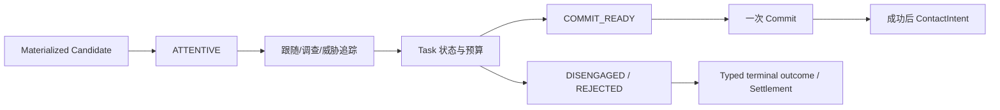

# FCF V1 遭遇转化（Encounter Conversion）机制设计（Design-only）

遭遇转化（Encounter Conversion）处理的是“遭遇候选（Candidate）已经成立后，
它如何与当前呈现（presentation）互动”。它不是第二次进入（Entry），也不是
接触/挂钩（Contact/Hook）的替代品。

## 0. 快速阅读

**概念**：遭遇转化是候选成立后的确定性互动状态机，负责把呈现事件
（presentation event）转换为任务状态，直到 `COMMIT_READY`、拒绝或脱离。

**整体机制**：只读取候选/物种（Species）/策略程序（Program）/呈现快照；
任务动作能力闸门（task capability gate）处理真正不可执行，软难度
（soft difficulty）留在任务动作预算；到达 `COMMIT_READY` 后只产生类型化
结果，只有承诺判定（Commit）成功才生成接触意图（ContactIntent）。

**配置方式**：配置特定动机的状态图（motive-specific state graph）、事件谓词、
任务动作剖面（task profile）、能力要求、超时/终态结果（timeout/terminal
outcome）和修订版本；禁止隐藏随机状态迁移（transition）。

**中文机制描述**：鱼已经进入遭遇后，系统按动作和事件一步步推进“关注、跟随、
追逐、拦截”；这段过程不重新抽鱼，也不能绕过承诺判定直接接触。



## 1. 前置条件

转化只能接收：

```text
materialized Candidate
+ atomic reservation snapshot
+ immutable presentation/event sequence
+ Species capability snapshot
  + BehaviorProgram task policy snapshot
```

没有候选、没有原子保留（reservation）或只存在待定提案（Pending proposal）
时，不得执行遭遇 AI、任务动作掷骰或接触意图。

## 2. 输入/输出边界

### 输入

```text
EncounterInput {
  candidate_snapshot
  presentation_truth
  world_fact_snapshot
  task_budget_profile_output
  elapsed_event_time
  history_snapshot
}
```

### 输出

```text
EncounterOutcome {
  state = APPROACH | INSPECT | COMMIT_READY | DISENGAGE | EXPIRED
  task_results[]
  contact_intent?       # populated only by downstream Commit success
  history_delta?
  owner_ids
  input_revisions
}
```

转化只输出类型化任务动作结果或 `COMMIT_READY` 结果；它不扣 PSU、不改变
物种能力、不重新生成机会（Opportunity），也不直接执行挂钩/终结结算
（Settlement）。

## 3. 确定性状态机

```text
APPROACH
  → INSPECT       presentation/event 满足 inspect predicate
  → DISENGAGE     hard task impossible 或 policy 明确放弃
  → COMMIT_READY  task predicate 满足且 candidate 仍有效

INSPECT
  → APPROACH      cue/event 改变但仍可继续
  → DISENGAGE     soft task 结果不足以继续
  → COMMIT_READY  commit predicate 满足

COMMIT_READY
  → emits typed COMMIT_READY outcome only
  → Commit (one decision)
  → ContactIntent only if Commit succeeds
  → CONTACT/HOOK downstream
```

相同候选快照与相同呈现事件序列必须得到完全相同的状态与输出。状态转换
只在语义事件边界执行，不得每帧重新随机决定。

## 4. 硬性 vs 软性任务动作（Hard vs soft task）

### 硬性不可执行（Hard impossible）

只有真正无法执行的能力/几何条件允许在转化前阻断：

```text
task_capability_gate(...) → ACTIONABLE | BLOCKED
```

`BLOCKED` 必须记录任务动作、能力、consequence_id、归属方（owner）、阶段、
修订版本和原因；不能伪装成较低的进入机会/E。

### 软难度（Soft difficulty）

距离、角度、流速、温度、DO、呈现质量等软因素只产生可观察的任务动作
输出，例如：

```text
task_result {
  pursuit_duration_s
  burst_budget_remaining
  orientation_error_deg
  confidence_band
  consequence_id
}
```

软难度不能在转化中变成一次新的进入掷骰；也不能在多个剖面重复消费同一个
物理后果（physical consequence）。

## 5. 任务动作预算剖面（Task-budget profile）

按照环境组合设计，所有温度/DO/流速/深度对当前任务动作的影响由一个声明的
`task_budget_profile` 一次性消费：

```text
budget = task_budget_profile(
  canonical_facts,
  task_id,
  capability_snapshot,
  history_snapshot
)
```

剖面必须声明单位、边界、缺失策略、组合算子和 consequence_id。输出被候选
快照固定；后续环境变化不能偷偷重算已成立的任务动作预算。

## 6. 承诺判定 / 接触 / 挂钩分离（Commit / Contact / Hook 分离）

```text
Encounter Conversion
  → COMMIT_READY
  → Commit (one declared decision)
  → ContactIntent
  → Contact arbitration
  → Hook compatibility
  → Settlement
```

- 转化：任务与状态变化；
- 承诺判定：一次是否提交的明确随机边界；
- 接触：容量、时间、几何竞争；
- 挂钩：嘴部/几何/钓组（rig）/时序兼容性（timing compatibility）；
- 终结结算：唯一终态交易（terminal transaction）。

转化不得直接调用接触仲裁（Contact arbitration）、生成接触意图或重复承诺
判定。只有承诺判定成功的下游步骤才能生成一个接触意图；该意图必须带稳定
语义意图 ID，抽象平局才可确定性裁决。

## 7. 随机性与重放（replay）

V1 转化默认完全确定性。随机性只允许在：

- 承诺判定的一次种子派生决策；
- 明确声明的下游接触平局裁决（稳定 hash）。

同一候选 ID 重试转化必须返回相同状态；候选被终结（settle）后，任何后续
转换请求必须返回终态/过期，而不能重新打开遭遇。

## 8. 历史增量（History delta）

转化可以产生类型化 `HistoryDelta`，但只交给历史/未来归属方在 END-CUT 应用：

```text
task outcome
→ one cause_id
→ one HistoryDelta
→ transaction_id idempotent apply
```

它不能即时修改饱食、警戒或恢复债务（recovery debt），也不能让任务动作
归属方直接持久化历史。

## 9. 编辑器

编辑器必须提供：

1. 状态图（State graph）：状态、谓词、允许的边和终态条件；
2. 能力面板：任务动作包络、硬闸门、软难度输入；
3. 任务动作预算面板：规范事实（canonical facts）、单位、边界、组合算子、
   consequence_id；
4. 事件序列预览：同一快照重放得到相同状态；
5. 承诺判定/接触/挂钩边界视图：显示下游归属方；
6. 历史增量面板：cause_id、transaction_id、END-CUT 应用契约；
7. 解释追踪（Explain trace）：每次转换的输入修订版本、输出、归属方和阻断
   原因。

编辑器禁止把软难度自动改写成进入惩罚，禁止给状态图添加未声明的随机边，
禁止让变体扩展物种任务动作能力。

## 10. 关键反例

1. 待定提案运行遭遇 AI；禁止。
2. 同一候选每帧重新掷“是否追击”；禁止，必须事件驱动且确定性。
3. 流速/DO 已进入任务动作预算，又在转化另扣同一耐力（endurance）；禁止。
4. 硬可执行性（Hard actionability）失败被实现成低 E；禁止，必须能力闸门
   判定 BLOCKED。
5. 转化直接执行挂钩、终结结算或生成接触意图；禁止。转化只能输出类型化
   结果，只有下游承诺判定成功后才生成接触意图。
6. 终结后重试转换重新产生接触；禁止，终态只读。
7. 两条任务动作路径写入同一个 HistoryDelta；必须由历史归属方合并且交易
   幂等。

## 11. 最小闭合结论

```text
Candidate snapshot
→ deterministic task state machine
→ one Commit boundary
→ ContactIntent
→ downstream Contact/Hook/Settlement
```

遭遇转化在任务动作剖面、状态边、随机边界和历史增量归属方未闭合前，
不应实现成一个自由组合的鱼 AI 状态树。
