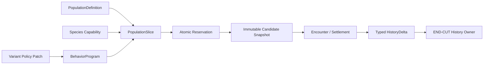

# FCF V1 鱼类实体（Fish Entity）/ 变体（Variant）设计契约

本文件把物种（Species）、种群定义（PopulationDefinition）、种群切片
（PopulationSlice）、行为策略程序（BehaviorProgram）、变体（Variant）、
遭遇候选（Candidate）和历史（History）的边界集中定义。它是设计契约，不要求
在参考原型（reference prototype）中模拟持久个体鱼（persistent individual fish）。

## 0. 快速阅读

**概念**：鱼类实体不是一个可任意改字段的巨型对象，而是种群定义、物种能力、
切片上下文（Slice context）、策略程序（Program policy）、变体和遭遇候选快照
（Candidate snapshot）的分层。

**整体机制**：种群定义管理 q/存量（stock）；物种定义能力；切片绑定生命周期；
策略程序定义当前策略；变体只做允许列表（allowlist）策略补丁（policy patch）；
原子保留（reservation）成功后才形成不可变遭遇候选快照，历史在 END-CUT
统一更新。

**配置方式**：在不同面板配置种群规模（population scale）、能力、切片、策略和
变体；能力/身份/归属方字段只读，变更必须创建新修订版本并接受评审。

**中文机制描述**：把“是什么鱼、哪批鱼、现在采用什么策略、这次遭遇是哪份质量”
分开建模，避免变体越权或旧遭遇候选被新配置追溯改写。



## 1. 六种不同语义的对象

| 对象 | 回答的问题 | 生命周期 | 是否可由变体改写 |
|---|---|---|---|
| `SpeciesCapability` | 这类鱼物理上/感知上能做什么？ | 产物版本（artifact version） | 否 |
| `PopulationDefinition` | 哪个可计量的存量（stock）与 `q`/队列（cohort）轴被管理？ | 产物版本（artifact version） | 否 |
| `PopulationSlice` | 当前哪一批可交换质量（exchangeable mass）、处于什么生命周期角色？ | 切片迁移（slice transition） | 否；只转移 PSU |
| `BehaviorProgram` | 这批鱼此刻采用什么策略？ | 策略修订版本（policy revision） | 可被声明的策略补丁选择 |
| `FishVariant` | 同一物种的受限策略变体是什么？ | 编译产物（compiled artifact） | 只能覆盖允许列表策略 |
| `Candidate` | 哪个已保留的有限质量正在经历这次遭遇（encounter）？ | 原子保留至终结结算（reservation 至 settlement） | 不可改写能力/策略 |

V1 默认不创建持久个体鱼。`Candidate` 是一次成功原子保留后产生的遭遇实体，
不能反向证明世界中存在一个持久个体。

```text
PopulationDefinition {
  population_id
  population_revision
  q
  cohort_axes[]
  history_scope = SLICE | COHORT
}
```

## 2. SpeciesCapability：稳定能力边界

最小字段：

```text
SpeciesCapability {
  species_id
  capability_revision
  population_definition_id
  anatomy_profile_id
  sensory_channels[]
  allowed_contact_types[]
  task_capability_ids[]
  thermal_capability_id
  oxygen_capability_id
  history_schema_id
}
```

`SpeciesCapability` 只引用一个外部 `population_definition_id`；种群身份、
队列轴与 `q` 的权威归属方是 `PopulationDefinition`，不是物种能力。两者必须
通过不可变引用（immutable reference）绑定，不能由变体改写。

这些字段描述能力或尺度，不描述“今天想不想做”。`q` 与种群身份属于
`PopulationDefinition` 边界（boundary）；接触类型、感知通道、热/氧上下限和
任务能力（task capability）属于 `SpeciesCapability` 边界。修改任一边界都
必须生成对应的新修订版本，并触发重校准（recalibration）和评审人签署
（reviewer sign-off）。

## 3. PopulationSlice：可转移的质量上下文

```text
population_slice_key = (population_id, cohort_key, lifecycle_role_key)

PopulationSlice {
  key
  capability_revision
  behavior_program_id
  entered_at
  minimum_hold_s
  hysteresis_policy_id
}
```

切片不拥有鱼的另一份总量。生命周期承诺（LifecycleCommitment）只在一个事务
（transaction）中把 PSU 从源切片转到目标切片，并记录 `from_key`, `to_key`,
`delta_psu`, `transition_id`。同一 `transition_id` 重放必须返回原结果；不同
增量（delta）冲突。

## 4. BehaviorProgram：当前策略

策略程序可以声明：

- 动机优先级和谓词（predicate）选择顺序；
- 栖息占位节点策略；
- 动机专属的进入机会等级（EntryOffer）；
- 任务剖面（task profile）的选择；
- 语义重评估（semantic reevaluation）触发、防抖（debounce）、滞回（hysteresis）；
- 已声明能力内的接触/任务选择。

策略程序不得声明：

- 新的 ContactType、感知通道（sensory channel）、任务能力或生理边界；
- 新增/销毁种群质量（population mass）的隐式操作；
- 直接写入 A/E/承诺判定（Commit）/挂钩（Hook）/终结结算（Settlement）的
  终态系数（terminal coefficient）；
- 将自身 ID 写入 `population_slice_key`。

## 5. 变体（Variant）：受限、可审计的策略补丁（policy patch）

### 5.1 合并算法

变体编译时绑定一个 `species_id` 和一个基准 `program_id`。编译器执行：

```text
validate species match
validate every override path ∈ POLICY_ALLOWLIST
validate value type / enum / range
apply overrides in canonical path order
emit flattened artifact + diff + source revision
```

运行时不做动态多层混入（mixin），也不接受未编译的变体。相同路径（path）的
多个补丁必须显式给出优先级；同优先级冲突直接拒绝。变体不能覆盖：

```text
population_definition.q
population_definition.population_id
species.anatomy_profile_id
species.sensory_channels
species.allowed_contact_types
species.*_capability_id
settlement_owners
population_slice_key
```

允许覆盖的例子：

```text
program.motive_priority
program.occupancy[*].grade
program.entry_offers[*].base
program.task_profile_id
program.trigger_policies[*]
```

### 5.2 版本和遭遇候选（Candidate）快照

变体或策略程序修订版本只影响之后物化（materialize）的遭遇候选。遭遇候选
必须保存：

```text
species_id + capability_revision
population_slice_key
program_id + program_revision
variant_id + variant_revision (or NONE)
world_snapshot_revision
history_schema_revision
semantic_snapshot_fingerprint
```

之后的编辑不能改变既有遭遇候选的遭遇语义；它只在下一次合法机会（Opportunity）
或生命周期切点（lifecycle cut）生效。

## 6. 遭遇候选（Candidate）与历史（History）的边界

遭遇候选只持有本次遭遇所需的不可变输入和原子保留引用：

```text
Candidate {
  candidate_id
  reservation_id
  proposal_id
  capability/program/slice snapshot
  presentation snapshot
  encounter_state
  commit_result
  terminal_settlement_id
}
```

遭遇候选不直接写饱食（satiation）、警戒记忆（wary memory）、温度驯化
（thermal acclimation）或种群质量。遭遇结束后只产生类型化 `HistoryDelta`；
历史/未来（History/Future）是唯一应用和持久化归属方，且以 `transaction_id` 幂等。若需要拆分多个
字段，`delta_id` 只能是绑定到该 `transaction_id` 的稳定子键，不能成为第二个
终态身份（terminal identity）。普通鱼的历史是切片/队列级；
若未来引入个体记忆，必须作为 V1.1 新身份/存储契约（identity/storage contract）。

## 7. 编辑器工作流

编辑器按能力→策略→变体三层显示，并在每次修改时显示：

```text
field path → owner → old/new value → affected revision
           → affected semantic fingerprint → recalibration requirement
```

保存操作必须是：

1. 对草稿做结构模式 + 语义校验（schema + semantic validation）；
2. 生成完整扁平化产物、机器 diff 和作者元数据（author metadata）；
3. 为能力/规模/归属方变化标记 `REVIEW_REQUIRED`；
4. 只有通过评审人的不可变版本才能编译给运行时。

编辑器不得自动把越权字段“降级成警告（warning）”，也不得把缺失能力、
世界事实或归属方补成默认值。

## 8. 必须保持的反例

1. **变体越权**：冷变体（cold variant）不能把偏好/温度能力
   （preferred/thermal capability）扩到物种未声明的范围。
2. **旧遭遇候选漂移**：策略程序编辑不能改变已物化遭遇候选的动机、任务剖面
   或接触曲目（contact repertoire）。
3. **质量重复计算**：切片迁移只能转移 PSU，不能另行创建相同质量。
4. **历史双写**：接触/挂钩不能直接写历史；只能提交类型化增量（typed delta）。
5. **补丁冲突**：同一覆盖路径的不确定合并不得依赖输入顺序。

## 9. V1 结论

```text
Species capability (stable)
  + Slice context (mass/lifecycle)
  + Program policy (current behavior)
  + optional Variant (allowlisted policy patch)
  → immutable Candidate snapshot after reservation
  → typed HistoryDelta at END-CUT
```

这套分层使工程师可以分别实现结构模式/编译器、解析器、快照和历史适配器
（History adapter），而不需要把“鱼”实现成一个可任意修改的巨型对象。
