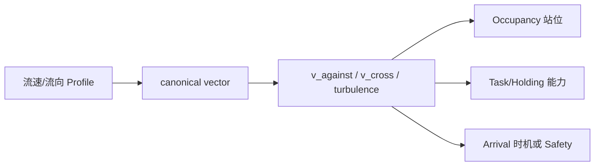

# FCF V1 流速/流向机制设计（Design-only）

> 作者成本旁证：局部窄流带与桥墩、开放水面等既有区域相交时的静态切分压力，
> 见 [Ogre Lake reproducible overlay experiment](ogre_lake_reproducible_overlay_experiment.md)。
> 该实验不改变本机制的归属方（Owner）、到达（Arrival）或安全（safety）契约。

流速不是一个“鱼更活跃/更难咬”的总系数。它描述水动力边界条件，必须
先区分鱼的定位选择、姿态维持、逆流游动成本和呈现（Presentation）到达时机。

## 0. 快速阅读

**概念**：流是带坐标系、方向、速度、湍流和不确定性（Uncertainty）的水动力向量事实。

**整体机制**：先把流向转换为规范坐标系（canonical frame）下的顺流/逆流/横流分量；再由
唯一归属方（Owner）分别结算站位、维持/任务预算（holding/task budget）、到达时序（arrival timing）或安全后果。

**配置方式**：世界事实（World Fact）配置流速剖面（flow profile）、坐标系、深度和数据质量；物种（Species）
配置游动/站位能力；策略程序（Program）选择站位/任务/到达策略，不直接写 E。

**中文机制描述**：流速不是“活跃度”，而是鱼能否站稳、逆流移动和呈现
何时到达的物理条件；这些后果分别处理，不能组成一个隐藏总惩罚。



## 1. 世界事实（World Fact）：水动力事实

```text
FlowFact {
  velocity_vector_mps
  turbulence_rms
  canonical_frame_id
  direction_uncertainty_deg
  measured_at
  location_id / depth_m / profile_id
  source_kind = SENSOR | HYDRO_MODEL | MANUAL_CALIBRATION
  quality = DIRECT | INTERPOLATED | STALE | MISSING
  uncertainty_mps
  source_revision
}
```

流向必须是向量，不得只存一个无符号 speed。节点局部坐标系、鱼的可用
方向和呈现的运动轨迹必须在同一快照（Snapshot）中确定。流速数据与
温度/DO 的校准输入可以相关，但下游只接收规范 `FlowFact`，不允许
解析器（Resolver）自己从 DO 或温度推算流速。

## 2. 鱼属性边界

### 物种能力（Species capability）

```text
FlowCapability {
  preferred_current_min_mps
  preferred_current_max_mps
  station_holding_max_mps
  burst_against_current_max_mps
  rheotaxis_profile_id
  turbulence_tolerance_profile_id
}
```

这些属性表达鱼“能否维持姿态/逆流移动”的物理能力。变体（Variant）不得扩展
能力上限；体型、生命阶段差异应由独立剖面（profile）表达。

### 策略程序 / 切片策略（Program / Slice policy）

```text
FlowPolicy {
  occupancy_mode
  avoidance_threshold_mps
  holding_strategy
  arrival_mode
  hysteresis_mps
  minimum_hold_s
  task_profile_id
}
```

策略程序只决定当前切片（Slice）如何使用能力（例如选择回水区或正面流），不
把策略写成物种的新能力。

### 历史（History）

```text
FlowHistory {
  recent_exposure_integral
  fatigue_debt
  last_reorientation_at
}
```

在 END-CUT 更新；遭遇候选（Candidate）快照后不被后续流速读数隐式改写。

## 3. 明确的三个物理后果

### 3.1 栖息占位（Occupancy）：长期站位适宜性

```text
v_against = max(0, dot(velocity_vector, local_upstream_axis))
v_cross   = magnitude(velocity_vector - projected_parallel_component)
w_flow_occupancy = holding_profile(v_against, v_cross,
                                    avoidance_threshold, preferred_range)
```

`local_upstream_axis` 来自 `canonical_frame_id` 与切片的趋流性（rheotaxis）
剖面；顺流/逆流不能仅由速度幅值（speed magnitude）判定。若某物种明确声明
仅幅值（magnitude-only）站位剖面，必须在剖面中写出“方向不影响该后果”
的适用前提。方向基准或不确定性改变会生成新的语义指纹（semantic fingerprint）。

`holding_profile` 在一次纯函数调用中同时解释逆流与横流分量，必须声明
横流边界和单位，并直接输出一个 `[0,1]` 权重；实现不得再对 `v_cross`
另乘隐藏惩罚。它只进入栖息占位分配器（Occupancy allocator），表示节点长期可站位质量。
它不创建鱼、不
触发迁移交易（transaction），也不直接进入 Entry/E。`station_holding_max` 是能力
边界；长期分布的回避阈值（avoidance threshold）必须是独立策略参数，避免把
“不能站住”与“当前运行时安全阻断”混成同一个归属方（Owner）。

### 3.2 转化（Conversion）：当前动作成本

```text
task_budget = task_budget_profile(
  velocity_vector, turbulence, task_id, fatigue_history
)
```

单一 `task_budget_profile` 一次性消费温度、DO、流速（flow）、深度（depth）等规范
事实（流速的局部投影也在此剖面内完成），输出带单位的爆发预算（burst budget）、
追击时长（pursuit duration）、转向成本（orientation cost）或恢复债务（recovery debt）。禁止同时用
`speed_penalty × turbulence_penalty × DO_penalty` 表示同一个用力（exertion）后果。

### 3.3 到达（Arrival）/T：呈现到达时机

只有当水流确实改变呈现的物理到达时间，才由到达（Arrival）/T 归属方（Owner）
处理：

```text
arrival_time = advection_model(path, velocity_vector, cast_motion)
```

它只改变到达时机或 ARRIVAL 机会（Opportunity）；不能再以同一流速后果降低
栖息占位（Occupancy）或进入（Entry）。若呈现已由外部运动系统给出确定到达
时间（arrival time），则 FCF 不再重新计算流速加成（bonus）。

## 4. 安全边界与不确定性

相对于能力（capability）的站位/逆流边界，区间完全安全为 `DEFINITE_SAFE`，
完全超出为 `DEFINITE_OUT`，相交为 `FLOW_RISK`，无可接受事实为 `UNKNOWN`（未知）。

- `FLOW_RISK`：禁止新的进入（Entry）、原子保留（Reservation）和生命周期进入；不追溯销毁
  已有遭遇候选（Candidate）；追踪记录（trace）记录区间、剖面、质量、修订版本和安全归属方（safety owner）。
- `UNKNOWN`：V1 默认不向该节点新增质量、不生成新遭遇候选，保持已有
  切片（Slice），并在追踪记录写入 `UNKNOWN_DATA_BLOCK`。
- 流速安全归属方只负责运行时阻断/声明迁移，不与栖息占位（Occupancy）的长期
  预分配重复结算。

## 5. 与温度、DO、深度的组合

| 组合 | 可接受语义 | 禁止 |
|---|---|---|
| 流速 + DO | 流速造成水动力阻力，DO 造成呼吸/恢复压力；必须是两个可区分的任务动作后果（task consequence） | 两者都叫“耐力下降”并双重相乘 |
| 流速 + 深度 | 深度用于取局部流速剖面；不是额外惩罚 | 深度先扣 A、流速再扣 E |
| 流速 + 温度 | 温度影响代谢剖面，流速影响外部阻力；各自 consequence_id | 用温度和流速重复表达同一预算（budget） |
| 流速 + 到达（Arrival） | 平流（advection）只在真实改变到达时间时拥有 T | 同一到达延迟再扣占位/进入 |

如果无法证明后果不同，V1 默认合并为一个声明清楚的剖面。

## 6. 解析器（Resolver）顺序

```text
FlowFact snapshot
→ coordinate/path normalization
→ local holding interpretation (Occupancy)
→ task-budget interpretation (Conversion, if Candidate exists)
→ arrival-time interpretation (Arrival/T, only if externally unresolved)
→ safety classification
→ safety gate (before any new Entry/Reservation/lifecycle-enter write)
```

安全分类（Safety classification）可以提前计算，但安全闸门（safety gate）必须先于任何新进入（Entry）、
原子保留（Reservation）或生命周期进入的写入；被阻断时不得产生新的账本事件（ledger event）。
它不追溯修改已经快照的遭遇候选（Candidate）。每个输出都带 `consequence_id`、
归属方、输入修订版本和阶段（stage）。

## 7. 编辑器

编辑器拆成：

1. 流速事实来源（Flow Fact source）：向量、湍流、坐标系、深度、质量、不确定性、修订版本；
2. 物种能力（Species capability）：站位/逆流/湍流剖面；
3. 切片策略（Slice policy）：站位维持（holding）、趋流性（rheotaxis）、滞回（Hysteresis）、最短保持；
4. 到达模型（Arrival model）：路径（path）、平流模型（advection model）、是否由外部运动系统提供到达时间；
5. 任务剖面（Task profile）：输出单位、边界、疲劳（fatigue）输入、唯一 consequence_id；
6. 归属方图（Owner graph）：`fact → consequence → owner → stage`。

保存时区分 `WORLD_SOURCE_CHANGE`、`CAPABILITY_CHANGE`、`POLICY_CHANGE` 和
`ARRIVAL_MODEL_CHANGE`；能力或尺度改变需要重新校准/评审签署（recalibration/reviewer sign-off）。

## 8. 反例

1. 只用流速标量、不用向量（vector），导致顺流/逆流被错误视为相同；除非
   剖面明确声明仅幅值（magnitude-only）适用前提，否则禁止。
2. 栖息占位（Occupancy）已降低站位质量，又在进入（Entry）以“流大”扣一次；禁止。
3. 任务剖面已扣逆流爆发预算，又用 DO/温度对同一预算双扣；禁止。
4. 外部系统已有到达时间，FCF 再用流速重掷 ARRIVAL；禁止。
5. 流速不确定性每帧触发一个新机会（Opportunity）；禁止，必须因果切点（Causal Cut）+ 稳定 ID。
6. 变体（Variant）把 `burst_against_current_max` 改到物种能力之外；禁止。

## 9. 最小闭合结论

```text
Flow vector snapshot
→ holding OR task cost OR arrival timing OR safety
→ distinct consequence_id
→ one owner
→ deterministic downstream effect
```

流速机制在归属方（Owner）图、向量坐标、到达归属和不确定性策略闭合前，
不应实现成一个通用 `current_multiplier`。
