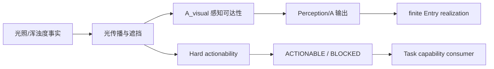

# FCF V1 光照与浑浊度机制设计（Design-only）

光照和浑浊度首先改变的是光传播与可观测性，不是鱼的数量，也不是自动
改变鱼的当前动机（Motive）。V1 先把“能否看见/分辨”与“鱼是否在场”严格分开。

## 0. 快速阅读

**概念**：光照与浑浊度共同描述光传播条件，不是鱼数量或咬口意愿。

**整体机制**：光学事实（OpticalFact）经传播/遮挡模型生成 `A_visual`；独立的硬可执行性闸门（Hard actionability gate）
只在视觉任务动作（Task）真正不可执行时返回 `BLOCKED`，不改写 A/E。

**配置方式**：世界事实（World Fact）配置 lux、NTU、光谱、衰减剖面、深度与修订版本；
物种（Species）配置感官能力；策略程序（Program）只能选择已声明的感知/任务策略。

**中文机制描述**：先算“信号能不能传到鱼那里”，再算“鱼有没有对应感官、
任务是否可执行”；看不清不等于鱼不在场，也不自动改变动机。

**作者成本伴随证据（companion evidence）**：Morning / Afternoon 阴影边界移动时，静态
手工 Region 为何需要预拆稳定子区，见
[Ogre Lake reproducible overlay experiment](ogre_lake_reproducible_overlay_experiment.md)。该实验
不改变 `A_visual`、栖息占位（Occupancy）或 TaskCapability 的语义边界。



## 1. 世界事实（World Fact）

```text
OpticalFact {
  illumination_lux
  turbidity_ntu
  spectral_band
  attenuation_profile
  measured_at / location_id / depth_m
  source_kind / quality / uncertainty
  source_revision
}
```

`illumination_lux` 与 `turbidity_ntu` 是物理事实。呈现（Presentation）的剪影（silhouette）、
闪光（flash）、振动（vibration）等由 `ActualPresentation` 编译，不由鱼解析器（Resolver）根据原始
物品 ID 猜测。每个因果切点（Causal Cut）固定光学快照与修订版本。

## 2. 三种不同后果

### 2.1 感知（Perception）归属方（Owner）：可见性与显著性

```text
A_visual = perception_profile(
  optical_fact, presentation_truth, fish_sensory_capability
)
```

`A_visual` 是该鱼对该呈现的空间/感官可达性（Access），不是探测成功（detect success），
也不是进入（Entry）/E。剖面必须说明是能见度（visibility）、对比度（contrast）、运动显著性（motion salience）
还是距离（range）哪一种后果；同一物理后果不得在多个感知通道再扣。

### 2.2 栖息占位（Occupancy）归属方（Owner）：长期光环境偏好

某些物种会选择阴影、明亮或低浑浊节点。该解释只进入长期栖息占位：

```text
w_light_occupancy = light_habitat_profile(optical_fact, slice_policy)
```

它不改变 `A_visual`，也不等价于“鱼没被看见”。如果同一光照变化既改变
长期站位又改变在场鱼的视觉可达性，必须登记两个不同 consequence_id。

### 2.3 安全（Safety）归属方（Owner）：极端环境

V1 不把普通浑浊度当作安全问题。只有明确声明的极端阈值（例如传感器/环境
模型判定不可生存）才产生 `OPTICAL_SAFETY_RISK`，并沿安全闸门（Safety gate）阻断新
进入/原子保留（Entry/Reservation）；不追溯销毁遭遇候选（Candidate）。普通“看不清”只能降低 A_visual。

## 3. 感知公式的边界

使用单一、可解释的感知剖面，而不是全局乘数（multiplier）：

```text
A_visual = profile(
  range_m,
  contrast_ratio,
  motion_salience,
  spectral_match,
  fish_sensory_channels
)
```

剖面输出 `[0,1]` 的可达性（Accessibility），并声明输入单位、边界、缺失策略和
归属方（Owner）。浑浊度不能同时降低距离、对比度、显著性后再由另一个模块以
“low light penalty”重复扣同一可见性后果；若输入确实对应不同感官通道，
必须有不同 consequence_id 和可审计组合算子。

## 4. 与进入（Entry）/遭遇（Encounter）的关系

```text
OpticalFact + ActualPresentation
→ A_visual
→ hard actionability gate (only true impossibility)
→ motive / E
```

硬可执行性闸门（Hard actionability gate）的语义归属方是 `Perception/TaskCapability`。
它只读取物种已声明的感官/任务能力与呈现事实（presentation truth），输出
确定性的 `ACTIONABLE` 或 `BLOCKED`；不修改 `A_visual`、不产生第二个
感知惩罚，也不直接写入 `E`。输出必须带 `consequence_id`、归属方、
阶段、输入修订版本和阻断原因。只有真正无法执行该任务动作时才返回
`BLOCKED`。

低 `A_visual` 不自动等于 `E` 低；鱼可能看不见呈现，但仍可能因
振动或水动力线索产生当前动机（Motive）。只有物种能力声明依赖视觉的
任务动作，才可在转化（Conversion）使用该任务的视觉输入。禁止把同一“看不清”在
感知、进入和遭遇各扣一次。

如果视觉依赖任务在转化使用视觉输入，必须证明它产生了与
`A_visual` 不同的任务后果（例如瞄准误差或识别失败），并使用
独立的 `consequence_id`；否则只能消费已有的 `A_visual`，不能再次扣减。

## 5. 数据不确定性

- `DEFINITE_VALID`：事实区间足以计算剖面；
- `OPTICAL_RISK`：关键安全边界不确定，安全（Safety）归属方阻断新进入；
- `UNKNOWN`（未知）：V1 默认不新增栖息占位质量、不生成新遭遇候选（Candidate），并在追踪记录
  写入 `UNKNOWN_DATA_BLOCK`；已有候选使用快照，不被追溯改写。

不确定性不能通过高频采样产生额外感知/进入判定。

## 6. 编辑器

编辑器必须分开：

1. 光学事实来源（Optical Fact source）：lux、NTU、光谱、衰减、深度、质量、修订版本；
2. 呈现编译器（Presentation compiler）：剪影、闪光、运动、光谱事实；
3. 物种感官能力（Species sensory capability）：视觉/运动/振动通道与距离剖面；
4. 感知剖面（Perception profile）：输入单位、边界、输出 `A_visual`、consequence_id；
5. 栖息占位策略（Occupancy policy）：长期光环境偏好；
6. 追踪/归属图（Trace/owner graph）：`fact → presentation relation → A_visual/occupancy → stage`。

变体（Variant）只能改变已声明的策略或呈现解释，不能新增
物种感官通道或绕过硬可执行性。

## 7. 反例

1. 浑浊度降低视觉可达性，却被解释为鱼离开节点；禁止，除非另有占位
   后果且归属方独立。
2. lux 与浑浊度（turbidity）都降低同一个对比度后果；必须合并剖面，禁止双扣。
3. 视觉不可见时仍有振动线索（vibration cue）；不得把 `A_visual=0` 写成硬拒绝（hard deny），除非
   该任务动作明确要求视觉且确实不可执行。
4. 高帧率光学采样反复触发进入；禁止，必须稳定机会（stable opportunity）。
5. 变体（Variant）把物种的视觉能力扩展到未声明通道；禁止。

## 8. 最小闭合结论

```text
Optical facts
→ presentation-specific perception profile
→ A_visual (not detect, not E)
→ optional independent occupancy consequence
→ deterministic downstream use
```

光照/浑浊度在感知剖面、感官能力和占位归属方未闭合
前，不应实现成一个全局 `visibility_multiplier`。
