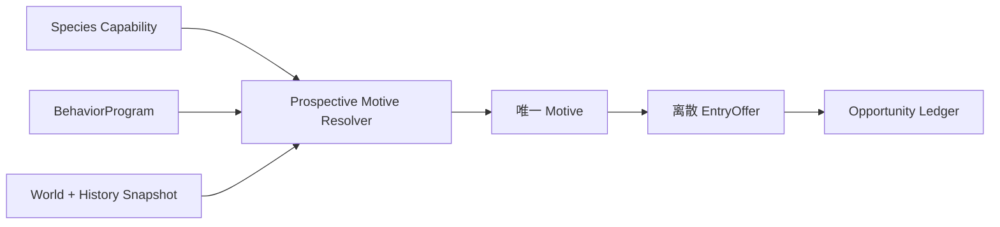

# FCF V1 当前动机（Prospective Motive）/ 行为策略程序（BehaviorProgram）设计（Design-only）

当前动机（Motive）是一次机会（opportunity）下对“鱼为何可能开始该遭遇
（Encounter）”的语义解释，不是鱼的持久人格、不是遭遇候选（Candidate），
也不是一个可随意叠加的加成（bonus）。行为策略程序（BehaviorProgram）是
当前种群切片（Population Slice）的策略；物种（Species）只定义能力边界。

## 0. 快速阅读

**概念**：当前动机是一次机会下“为何开始接近”的确定性解释；行为策略程序
是当前切片的策略，不是物种能力或持久人格。

**整体机制**：策略程序（Program）按显式优先级检查快照谓词（snapshot
predicates），从 `FORAGE/DEFEND/INVESTIGATE/NONE` 中选一个当前动机，再生成
一个离散的进入机会等级（EntryOffer）；相同输入必须得到相同结果，随机性不在
当前动机内发生。

**配置方式**：配置当前动机优先级、类型化谓词（typed predicates）、能力要求
（capability requirements）、进入机会等级基准/修正（base/modifier）、触发器
（trigger）、防抖/滞回（debounce/hysteresis）和修订版本（revision）；同优先级
可重叠规则编译失败。

**中文机制描述**：先决定“鱼为什么值得开始这次互动”，再决定“是否给出进入
机会”；它不会先随机抽一条鱼，也不会把多个动机分数相加。



## 1. 三类输入

```text
Species capability       能做什么
BehaviorProgram policy   当前 Slice 倾向怎样使用能力
Snapshot facts/state     当前 world fact + History revision
```

解析器（Resolver）不得读取未快照的实时数据，也不得向物种能力写入当前情绪。
候选形成后，当前动机与其输入指纹（fingerprint）一并快照。

## 2. 当前动机输出

```text
ProspectiveMotive {
  motive = FORAGE | DEFEND | INVESTIGATE | NONE
  confidence_band = NONE | WEAK | NORMAL | STRONG
  cause_ids
  owner = motive_resolver
  input_revisions
}
```

`confidence_band` 是规则解释强度，不是额外概率；真正的进入随机性只在进入
机会等级的明确边界发生。`ESCAPE` 等未进入 RC4 `EntryMotive` 枚举的动机属于
V1.1/延迟（deferred），不得出现在 V1 交付物（artifact）中。`NONE` 表示没有
合法当前动机，不产生提案（proposal），但不改变种群 PSU。

## 3. 行为策略程序结构

```text
BehaviorProgram {
  program_id
  slice_role
  allowed_motives
  priority_rules[]
  entry_offers[motive]
  task_profiles
  reevaluation_triggers
}
```

每条优先级规则（priority rule）必须声明：

```text
rule_id, priority, when_facts, when_history, required_capabilities,
output_motive, cause_id, effective_interval
```

相同优先级的谓词重叠时编译失败；不能依赖配置文件顺序。规则只能输出已声明
当前动机，不能直接输出 E、候选、接触类型（ContactType）或终结结算。

## 4. 唯一解析器顺序

```text
read immutable world/history snapshot
→ filter rules by slice/program/capability
→ evaluate predicates deterministically
→ choose highest-priority matching rule
→ emit one ProspectiveMotive
→ evaluate one motive-specific EntryOffer
→ consume one Opportunity
```

禁止替代实现（alternate implementation）：

```text
先随机抽鱼/抽 motive
→ 再检查 world fact 或 capability
```

也禁止把多个当前动机线性相加成“总动机分数”；若产品需要混合行为，必须
定义一个新的离散当前动机和其规则，否则结果不唯一。

## 5. 世界事实（World Fact）与历史的使用

世界事实说明节点/事件当前发生了什么；历史说明该切片到本因果切点为止
发生过什么。二者可同时作为谓词输入（predicate input），但必须保持后果
（consequence）区分：

```text
resource_state → node-resource cause_id
satiation      → internal-state cause_id
```

如果两者表达同一个“鱼不开始觅食”后果，只能由一个当前动机规则解释，
不能在栖息占位和进入机会等级各扣一次。

## 6. 触发器（Trigger）与重新求值（reevaluation）

允许的触发器必须是语义事件，不是每帧布尔值：

```text
trigger_id
semantic_event_type
debounce_s / hysteresis
source_revision_basis
scope_id
```

同一触发器在同一作用域（scope）/修订版本只能消费一次。若相同 `trigger_id`
在新的 `source_revision` 或语义指纹（semantic fingerprint）下再次出现，不能
仅按字符串去重：必须拒绝为身份冲突（identity conflict），或生成包含新
修订版本/指纹的新语义触发器身份。输入频率、FPS、暂停/恢复或抛竿重置
不得创造额外当前动机机会。若重新进入新作用域，必须产生明确的
`NEW_SCOPE_AFTER_REENTRY` 身份，而不是复用旧事件或隐式重掷。

## 7. 进入机会等级（EntryOffer）的边界

```text
E = entry_offer(program, selected_motive, presentation_truth, snapshot)
```

进入机会等级只能表达“该当前动机是否开始遭遇”，输出现有 `EntryGrade`
（包括 `NONE` 作为拒绝）；不得引入未声明的 `DENY` 类型。它不能改写 A、
栖息占位、物种能力、PSU 或任务动作预算（task budget）。同一原因在当前动机
与进入机会等级中若表达同一后果，必须合并；若是两个可区分后果，分别登记
consequence_id。

## 8. 随机性边界

V1 随机性只允许出现在明确声明的进入/承诺判定（Commit）/接触（Contact）决策
边界：

- 当前动机规则选择：确定性；
- 规则优先级/重叠：编译期确定；
- 进入机会等级（grade）：确定性输入；
- 有限进入实现（finite Entry realization）：二项（Binomial）/伯努利
  （Bernoulli）的明确抽取（draw）；
- 遭遇转化：固定快照下确定性；
- 承诺判定：一次确定性种子派生掷骰（seed-derived roll）；
- 接触平局（tie）：声明稳定平局裁决（tie-break）。

禁止为“更自然”在当前动机解析器中加入未持久化随机数。

## 9. 编辑器

编辑器必须提供：

1. 能力面板（Capability panel）：只读展示物种能力和策略程序可选范围；
2. 规则表/图：优先级、谓词、输入事实/历史、输出当前动机、cause_id；
3. 重叠检查器（Overlap checker）：相同优先级重叠直接阻断保存；
4. 触发器面板：稳定 ID、防抖、滞回、作用域/修订版本；
5. 进入机会等级面板：当前动机 → 等级/拒绝的离散规则；
6. 追踪预览（Trace preview）：输入快照、命中规则、未命中原因、当前动机、
   E、机会 ID；
7. 版本差异（Version diff）：区分 POLICY_CHANGE、HISTORY_INPUT_CHANGE、
   TRIGGER_CHANGE。

编辑器不得自动排序相同优先级、补全缺失 cause_id、把规则顺序当语义，或
允许变体（Variant）新增未声明当前动机/能力。

## 10. 关键反例

1. 高帧率重复调用解析器产生多个当前动机掷骰；禁止，机会/触发器去重。
2. 先按丰度（abundance）随机抽鱼，再判断当前动机；禁止，违反因果顺序。
3. `FORAGE + DEFEND` 相加成 1.4 的总分；禁止，必须选一个离散当前动机。
4. 资源稀缺（resource scarcity）同时降低栖息占位和 E，却没有不同
   consequence_id；禁止。
5. 策略程序选择物种未声明的任务动作/接触；编译拒绝。
6. 候选已快照后，实时历史改写其当前动机；禁止。
7. 规则优先级相同且重叠，依赖 YAML 顺序；编译拒绝。

## 11. 最小闭合结论

```text
immutable snapshot
→ deterministic rule selection
→ one ProspectiveMotive
→ one motive-specific EntryOffer
→ one stable Opportunity consumption
```

当前动机机制在规则优先级、输入修订版本、触发器身份、随机性边界和后果
归属方未闭合前，不应实现成一个可调的 `motivation_score`。
