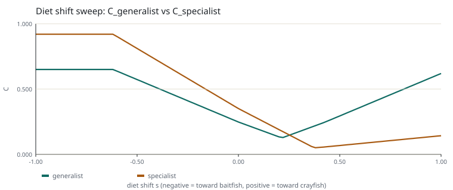
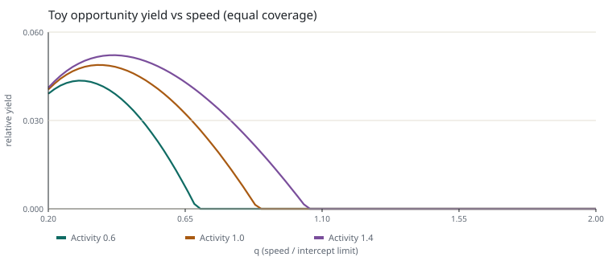
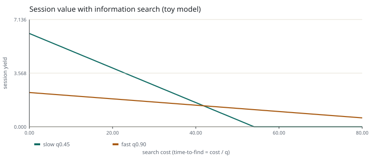
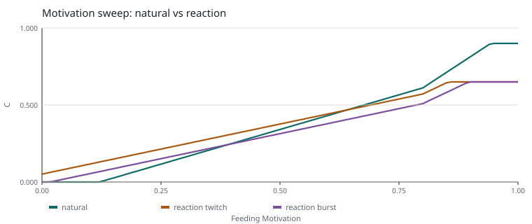
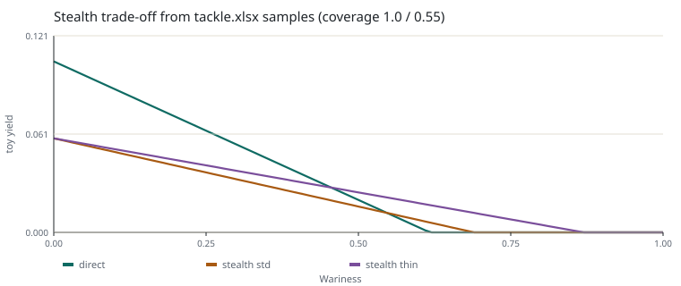
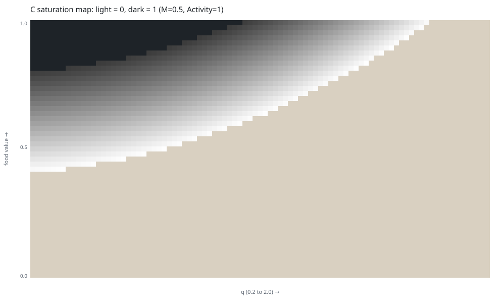

# Proposal C 策略翻转验证报告

状态：独立实验 / Candidate 输入 / 非生产结论。
模型基线：`futouyiba/HitFish-Up` `main` @ `dcba9ee9`（2026-11-05）。
实验仓基线：`futouyiba/programaticHitFish` `main` @ `80af4d2`。
运行入口：`experiments/proposal_c_strategy_flips/run.py`。

---

## 0. 结论摘要

**当前模型能产生一种稳定、合理、可解释的策略翻转，但不是四条轴都能。**

| 策略轴 | 结论 | 证据 |
|---|---|---|
| 泛用饵 vs 专精饵（DietShift） | **结构可行**：翻转稳定，边界随支持度小幅移动 | 交叉点 `s ≈ 0.2524` 档；支持度扰动下边界在 `0.228–0.276` 档之间 |
| 快速搜索 vs 慢速精钓（Activity） | **存在退化**：慢速在 Response 与玩具机会模型里都占优；快搜没有可用的补偿通道 | 快搜 C 在低活跃时恰为 0；综合收益需 `2.72×` 覆盖才能追平 |
| 自然呈现 vs 反应口（Motivation） | **参数敏感**：翻转存在，但高动机一侧很薄；低动机时反应口接近无代价最优 | 交叉点 `M ≈ 0.65`（twitch）与 `0.40`（burst）；高动机侧仅差 1.5 个百分点 |
| 直接钓组 vs 隐蔽钓组（Wariness） | **数据可建，翻转条件苛刻**：用 tackle.xlsx 样例加 `clarity` 测试字段后，55% 覆盖下 `W ≈ 0.46` 翻转 | 中低风险下隐蔽需保住 65%–88% 覆盖；翻转靠直接方案先归零，不是隐蔽本身强 |

快搜还有一条未进入当前模型的通道：第一次进入钓场时鱼群位置未知，“找鱼”本身有价值。
把定位时间设为 `search_cost / q` 后，`search_cost > 42` 时快搜的总收益反超；
这是假设模型，说明 Opportunity 需要一条发现/覆盖通道。

另有两个横向问题：

- **饱和**：在 `food × q` 的 4,641 个采样点上，72.8% 的 C 恰好等于 0 或 1，只有 27.2% 落在中间带。大量策略比较会退化成“都满”或“都零”。
- **响应层的翻转不等于玩家价值**：Diet 轴的翻转有清楚的行为解释，但当前没有规定玩家如何观察到食性偏移；没有可观测线索时，玩家学不到这条策略差异。

---

## 1. 口径、版本与限制

### 1.1 读入的现行文本

| 文件 | 用途 | 状态 |
|---|---|---|
| `docs/proposals/lure-response-proposal-c-evaluation-items.md` | 五项公式、档位标尺、工作域 | Candidate |
| `docs/proposals/lure-response-proposal-c-semantic-contract.md` | 语义与状态协议 | Candidate |
| `docs/proposals/lure-response-proposal-c-response-algorithm-v1.md` | 端到端伪代码、sibling max、失败对照 | Candidate |
| `docs/proposals/lure-response-proposal-c-fish-condition-mechanism-contracts.md` | Activity / Motivation / DietShift / Wariness 的输出域 | Candidate |
| `docs/proposals/lure-response-proposal-c-opportunity-l-production.md` | `L = r × τ` 与玩具近似 | Candidate |
| `prototypes/lure-response/proposal_c_end_to_end_probe.py` | 数值对照 | Working probe |
| `prototypes/lure-response/proposal_c_opportunity_support_probe.py` | 机会玩具模型 | Working probe |

2026-11-05 的最新变更已核对：档位锚为 `0 / 0.25 / 0.60 / 1.0`，版本 `tier-v2`；
门槛 `M=0.5 → 0.40` 与档位标签解耦；攻击诱因分为猎物侧 `StateMatchStrength` 与鱼侧
`TriggerEvaluation`，第一版默认等值。本实验按这些口径计算，没有使用旧研究分支公式。

### 1.2 本实验的显式假设

- **输入是示意夹具**：支持度、基础亲和、可疑负荷都由 `fixtures.json` 指定，不是鱼种数据。
- **Opportunity 是玩具模型**：`r = q/(1+q/Q_cap)`、`τ = D/(D+q)`、`coverage` 为常数。
  所有综合收益标为 *toy yield*，不是游戏真实效率。
- **q 是归一化速度**：`q = 相对水速 / InterceptSpeedLimit`。没有 `InterceptSpeedLimit`
  生产数据，因此按鱼种命名的结论一律标为 `Blocked`；速度维度用 q 扫描覆盖。
- **不修改任何 Contract 或生产代码**；本报告不获得规范地位。

---

## 2. 方法

### 2.1 计算公式（按当前契约转写）

```text
food    = clamp(U(clamp(T(base) + s, 0, 3)) + size, 0, 1)
trigger = 0.10 × StateMatchStrength
closing = 0.19 × q² × clamp(1/A, 0.5, 2)
risk    = 1.0 × Wariness × SuspicionLoad
threshold = 0.60 − 0.40M − 0.50 × max(0, M − 0.80)
margin  = food + trigger − closing − risk − threshold
C       = clamp(margin / 0.40, 0, 1)
C_feed  = max over resolved sibling branches (support × C)
```

玩具机会模型：

```text
r(q)   = q / (1 + q)
τ(q)   = 0.80 / (0.80 + q)
toy_yield = coverage × r × τ × C
```

### 2.2 对照设计

四条轴，每条两个鱼况场景，除研究变量外全部固定：

| 轴 | 策略 | 鱼况变量 | 固定项 |
|---|---|---|---|
| A Diet | 泛用（两猎物 0.65/0.65） vs 专精（0.92/0.15） | DietShift 0 / ±1 档 | q=0.50, A=1.0, M=0.5 |
| B Activity | 慢速 q=0.45 vs 快搜 q=0.90 | Activity 0.6 / 1.4 | M=0.5, food base 0.55 |
| C Motivation | 自然 vs 反应（同速、burst 两种） | Motivation 0.2 / 0.7 | q=0.60/0.75, support 0.90 vs 0.65 |
| D Wariness | 直接（覆盖 1.0） vs 隐蔽（覆盖 0.55） | Wariness 0.1 / 0.8 | 无显眼度字段，SuspicionLoad=0 |

---

## 3. 结果

### 3.1 泛用饵 vs 专精饵：稳定翻转

| 场景 | 泛用 C / toy yield | 专精 C / toy yield | 排序 |
|---|---|---|---|
| A1 无偏移 | 0.2478 / 0.0508 | **0.3508 / 0.0719** | 专精 |
| A2 向小龙虾偏一档，同时远离小鱼 | **0.6192 / 0.1270** | 0.1429 / 0.0293 | 泛用 |

翻转点：`s ≈ 0.2524` 档（向小龙虾方向）。泛用饵的优势来自它在两种猎物上都不差；
专精饵的优势来自单猎物支持度高，但食性一偏就失去主分支。

稳定范围：把泛用支持度在 0.55–0.75、专精主支持度在 0.85–0.97 之间扰动，交叉点在
`0.228–0.276` 档之间移动，极差约 0.05 档。翻转不是单一参数点的巧合。



**行为解释**：鱼转向某种猎物后，专精饵的高支持度用不上，泛用饵仍能在新猎物上拿到中等响应。
这个理由玩家可以从“最近鱼吃什么”理解，前提是游戏把这条信息表达出来。

### 3.2 快速搜索 vs 慢速精钓：没有翻转，慢速支配

| 场景 | 慢速 C / yield | 快搜 C / yield |
|---|---|---|
| B1 Activity 0.6 | **0.1825 / 0.0362** | 0.0000 / 0.0000 |
| B2 Activity 1.4 | **0.2604 / 0.0517** | 0.0852 / 0.0190 |

快搜在低活跃时 C 恰为 0：`0.19 × 0.9² × 1.667 = 0.257` 的追赶成本直接吃掉全部余量。
q 从 0.2 到 2.0 的全扫描显示，最优点在 `q ≈ 0.30–0.42`，比夹具里的 0.45 还低；
0.45 与最优点相差不到 3%，而 0.90 在低活跃时直接归零。快搜没有任何胜出区间。

玩具机会模型也没有救回快搜：`r` 的上升被 `τ` 的下降抵消，`rτ` 只从 0.1986 升到 0.2229
（+12%），而 C 下降更多。在夹具的 0.45 对 0.90 这一对上，快搜要追平需要 `2.72×` 的覆盖优势。



**这是结构缺口，不是参数问题**：当前 Opportunity 模型按“单个颗粒的有效遭遇”计价，
没有任何项奖励“单位时间扫过更多水域”。快搜的真实收益在游戏里来自找到更多鱼，
而模型没有这条通道。加大覆盖参数可以造出翻转，但那是假设，不是模型能力。

**加入信息搜索后的敏感性（Owner 指出的“黑盒”问题）**：第一次进入一个时段或钓场时，
鱼群位置未知。设“找到可钓鱼群所需时间”为 `search_cost / q`，总可用时长 120，
每颗粒收益仍取 B2 的数值，则：

```text
session_value(q) = max(0, 120 − search_cost / q) × per_grain_yield(q)
```

当 `search_cost > 42` 时，快搜反超：慢速要 93 分钟才定位，只剩 27 分钟作钓；快搜 47 分钟定位，
剩 73 分钟。也就是说，**只要找鱼成本足够高，快搜从“全面吃亏”变成“更优”**。
42 是假设参数，不是标定值；它说明 Opportunity 需要一条“发现/覆盖”通道，
而不是说当前模型已经支持快搜。



### 3.3 自然呈现 vs 反应口：有翻转，但高动机一侧很薄

| 场景 | 自然 C / yield | 抽动式反应 C / yield | burst 反应 C / yield |
|---|---|---|---|
| C1 Motivation 0.2 | 0.0711 / 0.0152 | **0.1813 / 0.0389** | 0.1188 / 0.0263 |
| C2 Motivation 0.7 | **0.5211 / 0.1117** | 0.5063 / 0.1085 | 0.4438 / 0.0982 |

交叉点：burst 反应在 `M ≈ 0.40` 让位给自然；抽动式反应在 `M ≈ 0.65` 让位。
低动机时，反应口的支持度乘前 C 从 0.079 拉到 0.279，分支贡献从 0.071 升到 0.181；高动机时自然反超，
但只差 1.5 个百分点（相对 3%）。



**参数网格**：在支持度 0.50–0.80、诱因强度 0.50–0.90、q 取 0.60 或 0.75 的 70 个组合里，
“低动机反应口胜、高动机自然胜”的完整翻转出现 47 次（67.1%）。翻转不是单个夹具点的产物，
但也不是普遍成立。

**稳定范围**：把反应饵的支持度从 0.50 扫到 0.90：

- 低动机（0.2）下，反应口在支持度 ≥ 0.26 时始终胜出；
- 高动机（0.7）下，自然只在支持度 ≤ 0.66 时胜出；
- 两个条件同时成立的支持度区间约为 `0.26–0.66`；当前夹具 0.65 靠近上边界，所以高动机一侧很薄。

这意味着：**反应口在“鱼不饿”时接近无代价的最优**，因为 0.10 的预算乘 0.8 强度，
在 0.40 宽的 C 区间里就是 0.20 的 C 增量；支持度从 0.90 掉到 0.65（-28%）也抵不过它。
只有当反应呈现明显降低猎物表达支持度时，饥饿的鱼才会重新偏好自然呈现。

### 3.4 直接 vs 隐蔽：用 tackle.xlsx 样例重建

从 `tackle.xlsx` 的 Lines / Leaders 抽取 9 条主线和 4 条前导线，按
`0.45 × (1−clarity) + 0.30 × 粗细^0.5 + 0.15 × (1−opacity/100) + 0.10 × 颜色对比`
计算可见度，再取整组最显眼部件。`clarity` 是新增的测试参数：现有配置只有
opacity 与颜色，无法表达“氟碳线在水中更不显眼”。权重与 0.5 的暴露系数都是假设。

| 方案 | 线 / 前导 | 可见度 | SuspicionLoad | 覆盖 |
|---|---|---|---:|---:|
| direct_nylon | 尼龙 1.0 号 / 单丝前导 | 0.751 | 0.375 | 1.00 |
| stealth_std_fluoro | 氟碳 1.0 号 / 氟碳前导 | 0.672 | 0.336 | 0.55 |
| stealth_thin_fluoro | 细氟碳 0.5 号 / 透明单丝前导 | 0.532 | 0.266 | 0.55 |
| heavy_direct | 粗尼龙 7 号 / 单丝前导 | 0.891 | 0.445 | 1.00 |

| 场景 | direct yield | std fluoro yield | thin fluoro yield | heavy direct |
|---|---:|---:|---:|---:|
| Wariness 0.2 | **0.0713** | 0.0412 | 0.0447 | 0.0649 |
| Wariness 0.6 | 0.0029 | 0.0075 | **0.0180** | 0.0000 |

在 55% 覆盖假设下，细氟碳的翻越点在 `Wariness ≈ 0.46`。但翻转的成因不是隐蔽方案变强，
而是直接方案的风险成本先把 C 压到接近 0：

| Wariness | 0.2 | 0.4 | 0.46 | 0.6 |
|---|---:|---:|---:|---:|
| 细氟碳追平直接所需覆盖 | 0.88 | 0.65 | 0.55 | 0.09 |

也就是说，中低 Wariness 下隐蔽要保住 65%–88% 的覆盖才不亏；只有高风险时，直接方案自己
先归零，隐蔽才以很低的覆盖胜出。现有配置能给出的可见度差只有 17%（标准氟碳）到 29%（细氟碳），
不足以在中低风险下抵消覆盖成本。



### 3.5 体型、鱼种与 Engagement Mode

- **体型**：尺寸调整只移动 FoodValue，对所有策略同幅；`-0.2` 到 `+0.2` 扫描没有改变泛用/专精
  的排序。足够负的尺寸会让双方一起落到 0（饱和），这是截断问题，不是策略差异。
- **鱼种**：没有 `InterceptSpeedLimit` 与鱼种级基础亲和数据。实验用 q 扫描覆盖速度维度，
  不对具体鱼种下结论。
- **Engagement Mode**：当前响应公式不按 mode 变化，mode 只通过鱼况快照进入。没有各 mode 的
  鱼况数据，无法检验“同一策略在不同 mode 下排序不同”；标记 `Blocked`。

### 3.6 饱和图



在 `M=0.5, Activity=1` 的网格上，72.8% 的点 C 恰好为 0 或 1。中间带是一条窄斜带。
后果：很多“策略比较”实际上是在比较 1 和 1、0 和 0；只有落在斜带上的输入才产生可读的排序差异。
这不是错误，但会掩盖机制差异，也会让玩家体验成“要么有效要么完全没反应”。

### 3.7 玩家决策价值：按 40% 相对差判断

Owner 给出可感知标准：**权重上要有 40% 以上的相对差距，玩家才感受得到**。
因此这里不再用绝对 C 差，而用 `(较大值 − 较小值) / 较小值`，即“高的一方比低的一方高多少”：

| 轴 | 相对差 | 是否过 40% | 可观察性 | 判断 |
|---|---:|---|---|---|
| Diet 无偏移 | 41.5%（专精高） | 刚好过线 | 需要“最近吃什么”的线索 | 值得，但很薄 |
| Diet 一档偏移 | 333%（泛用高） | 过线 | 同上 | 值得 |
| Reaction 低动机 | 155%（反应口高） | 过线 | 鱼是否进食可见 | 值得 |
| Reaction 高动机 | 2.9%（自然高） | 不过线 | 同上 | 不值得改打法 |
| Speed（B2） | 206%（慢速高） | 过线 | 速度可见 | 慢速明确更优 |
| Stealth 低风险 | 59.5%（直接高） | 过线 | 显眼度不可见 | 直接更优 |
| Stealth 高风险 | 521%（细氟碳高） | 过线 | 同上 | 隐蔽更优，但靠直接归零 |

40% 规则让 Diet 无偏移这条翻转变得“刚好成立”：41.5% 只比门槛高 1.5 个百分点。
如果改用“以较大值为分母”的保守口径，同一差距只有 29.4%，就不过线；两种口径下结论不同，
说明这条策略处在可感知边缘，需要线索设计补强，不能当作稳定卖点。

---

## 4. 对模型的反例攻击

| # | 检查 | 结果 |
|---|---|---|
| 1 | 某拟饵/手法长期统治 | 慢速在 B 轴全胜；D 轴低风险直接胜、高风险细氟碳胜；A、C 轴存在分化 |
| 2 | 鱼况变化大但最佳策略不变 | B 轴 Activity 0.6→1.4 不改变最优策略（慢速）；D 轴会随 Wariness 翻转 |
| 3 | 两个状态参数重复结算同一结果 | Activity 只进 Closing，Motivation 只进门槛，DietShift 只进 FoodValue，Wariness 只进 Risk；没有发现重复项。反应口的 burst 同时抬高 q（成本）与诱因（收益），净余量在 q=0.75 时仍 +0.0415，属于契约允许的“同一事实、不同作用” |
| 4 | 截断/饱和让策略都变成 0 或 1 | 72.8% 的采样点饱和；低活跃快搜恰好为 0；尺寸 -0.2 时双方同时为 0 |
| 5 | 翻转需要极端参数 | Diet 翻转在 0.25 档附近，正常；反应口翻转在 70 组参数里出现 67%，但高动机余量薄；快搜需要 2.72× 覆盖；隐蔽翻转依赖 55% 覆盖假设 |
| 6 | 泛用饵始终优于专精饵或相反 | 没有；排序随 DietShift 翻转 |
| 7 | 快搜在 Response 吃亏，综合收益是否更好 | 纯颗粒模型下不会；加入找鱼时间后，`search_cost > 42` 时快搜反超（假设模型） |
| 8 | 反应口是否无代价普遍最优 | 低动机时接近普遍最优；高动机时自然仅在支持度 ≤ 0.66 时胜出 |
| 9 | Wariness 缺字段时是否误称隐蔽已通过 | 没有；用 tackle.xlsx 样例补了测试数据，但翻转依赖 55% 覆盖假设，报告标为条件成立 |
| 10 | Unknown / NotConfigured / Reject 被当成 0 | 没有：Unknown/NotConfigured → ResolutionIncomplete，Reject → typed zero，Resolved 0 保持为 0；混合分支中未知分支被跳过并记录，已知分支仍参与 max |

状态对照（`results/results.json` 的 `protocol`，含缺失猎物状态与缺失支持度两个分支）：

```text
resolved_zero       Resolved, C=0.0
unknown             ResolutionIncomplete
not_configured      ResolutionIncomplete
reject              Reject, C=0.0
invalid             InvalidInput
mixed_unknown_branch Resolved, C=0.63125, skipped={crayfish: Unknown}
missing_trigger      ResolutionIncomplete   # 不默认成 0
missing_support_sibling Resolved, skipped={crayfish: Unknown}
```

---

## 5. 翻转边界与稳定范围

**关于“是否调参调出翻转”**：本实验没有独立的事后 holdout。参数网格是在同一套公式内做的
敏感性检查，只能说明翻转不是单一夹具点的产物，不能排除夹具选择偏差；报告把这一点当作限制，
而不是证明。

| 轴 | 翻转点 | 稳定范围 | 翻转幅度 | 判定 |
|---|---|---|---|---|
| Diet | `s ≈ 0.25` 档 | 0.228–0.276（支持度扰动）；9 组支持度组合全部存在翻转 | 0.35 vs 0.25（无偏移）；0.62 vs 0.14（一档偏移） | 稳定 |
| Activity | 不存在 | 无；最优 q≈0.30–0.42，0.45 已接近最优 | 快搜需 2.72× 覆盖 | 退化 |
| Motivation | `M ≈ 0.65`（twitch）/ `0.40`（burst） | 支持度 0.26–0.66 内两面都成立；参数网格 67% 存在完整翻转 | 低动机 2.55×；高动机 1.03× | 参数敏感 |
| Wariness | `W ≈ 0.46`（细氟碳 vs 直接，55% 覆盖假设） | 中低风险需 65%–88% 覆盖；高风险靠直接归零 | 0.071 对 0.045（低风险）；0.018 对 0.003（高风险） | 条件成立 |

---

## 6. 问题归因

| 现象 | 归因 | 说明 |
|---|---|---|
| Diet 轴可翻转 | **机制结构成立** | 档位迁移 + 支持度分流按预期工作；边界对支持度不敏感 |
| 快搜被支配 | **Opportunity 结构缺口** | 当前 L 按颗粒计价，没有搜索广度/覆盖通道；Response 的平方成本又放大了速度劣势 |
| 反应口低动机近乎最优 | **参数标定** | TriggerBudget 0.10 在 0.40 的 C 区间里权重很大；支持度惩罚不足以抵消 |
| 反应口高动机翻转脆弱 | **参数标定 + 夹具位置** | 0.65 支持度靠近临界值；不是机制不能翻转，而是余量太薄 |
| 隐蔽策略条件翻转 | **输入数据部分可用 + 覆盖假设未闭合** | `tackle.xlsx` 给出直径/颜色/透明度，但没有 clarity 字段；覆盖成本 55% 是假设，翻转靠直接方案先归零 |
| 大面积饱和 | **投影结构 + 标定** | 线性投影区间窄（0–0.40），两端截断；M1 与工作域未按分布校准 |

---

## 7. 最小修正建议（未实施）

1. **Opportunity 增加搜索广度通道**：让速度或单位时间扫过的有效区域进入 `L` 的生成，
   而不是只按单颗粒停留计价。否则快搜在模型里永远无法成立。
2. **给 Trigger 设一个可证伪的支配性测试**：例如“在合理支持度下，反应口不得在低动机场景
   无条件胜出”；若不满足，调整 `TriggerBudget` 或把支持度惩罚显式化。当前 0.10 的预算
   在 0.40 的 C 区间里相当于 0.2 C，偏大。
3. **标定 M1 或改用分档/带内报告**：72.8% 饱和意味着很多比较没有分辨率；至少在玩法层
   用 C 的分档或排序，而不是把 0.01 的 C 差当成稳定收益。
4. **把 `clarity` 做成正式字段，并先测覆盖成本**。`tackle.xlsx` 的直径、颜色、透明度已经够建可见度模型；
   现在缺的是材料清晰度与隐蔽方案实际损失多少覆盖。没有这两项，不声称隐蔽策略已验证。
5. **Diet 轴保持不动**，但补一个玩家可观测线索（例如近期食谱或季节提示），否则翻转只存在
   于数值层，玩家无法学习。
6. **Opportunity 的搜索/发现通道**：把“单位时间扫过多少新水域”折算成找到鱼群的概率或期望时间。
   实验里 `search_cost > 42` 就足以让快搜反超，说明这条通道的量级不需要很大，但必须显式存在。

以上都是建议，本实验没有修改任何机制或参数。

---

## 8. 复现与验证

```bash
cd experiments/proposal_c_strategy_flips
python3 run.py
```

脚本断言覆盖：

- Diet 轴交叉点存在且位于 `(0, 1)`；
- 慢速在两个活跃度下都高于快搜；
- 低动机反应口胜、高动机自然胜；
- Wariness 改变时 C 完全不变；
- Unknown / NotConfigured / Reject / InvalidInput / Resolved 0 的状态边界；
- 混合分支中未知分支被跳过、已知分支仍可结算；
- 缺失 `StateMatchStrength` 不得默认成 0；
- 关键数值（交叉点、覆盖比、饱和率、支持度区间）被钉死，公式或夹具漂移会让断言失败；
- 隐蔽轴使用 `tackle.xlsx` 抽样数据，覆盖需求随 Wariness 的曲线被写入结果；
- 搜索模型的总时长、定位时间与翻越成本写入结果，属于假设而非标定。

全部断言通过。输出文件可直接 diff。

---

## 9. 本实验不能证明什么

- 不能证明真实玩家的选择；没有 playtest。
- 不能证明鱼种参数正确；夹具不是生产数据。
- 不能证明综合收益；Opportunity 是玩具模型。
- 不能证明 `L`、`K(n)` 或圆桌接口的最终形态。
- 不能把任何结果升级为 Contract 或生产参数。
